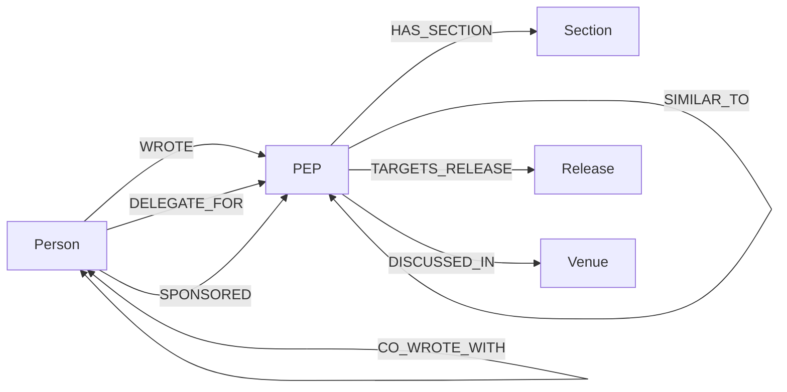

# Company Brain on FalkorDB: Python Governance Knowledge Graph

[](https://www.falkordb.com/)
[](#)
[](https://www.python.org/)
[](LICENSE)

An enterprise knowledge graph and autonomous AI agent that analyzes the entire institutional memory and governance evolution of the Python programming language through **Python Enhancement Proposals (PEPs)**.

Unlike naive document search or basic Top-K vector retrieval, **Company Brain** walks connected relationships in **FalkorDB** to answer complex governance questions: *who made key architectural decisions, which foundational designs were abandoned or replaced, which rejected ideas were resurrected, and which active standards are orphaned.*

---

## 1. Why GraphRAG Beats Plain Vector RAG (The "Kill Test")

Standard RAG (chunking text + vector similarity + top-k retrieval) fails completely on complex institutional questions:

| Question Type | Why Plain RAG Fails | How FalkorDB Graph Solves It |
|---|---|---|
| **Multi-hop Lineage (Q1)** | Lineages span chains of unknown depth (e.g., Packaging Metadata `566 -> {426, 345} -> 314 -> 241`). Similarity search cannot follow sequential directed edges. | Traverses variable-length directed paths `(n)-[:REPLACES*1..8]->(o)` returning exact maximal DAG chains. |
| **Centrality & Prestige (Q2, Q4)** | Plain RAG cannot identify foundational vs deprecated proposals across 700+ documents. | Runs native graph algorithms (`algo.pageRank`, `algo.betweenness`) over citation and co-authorship networks. |
| **Global Absence Queries (Q7)** | Vector similarity can never prove an edge *does not exist* anywhere across the entire corpus. | Evaluates negative pattern predicates: `WHERE NOT ()-[:CITES\|REQUIRES]->(f)`. |
| **Temporal Cross-Checks (Q5, Q6)** | Plain chunks do not enforce date-order constraints across status boundaries. | Joins `(r:PEP {status: 'Rejected'})<-[:CITES]-(f:PEP {status: 'Final'}) WHERE f.created > r.created`. |

---

## 2. Graph Data Model (Schema v1.1)

Every node and edge is extracted deterministically from raw PEP reStructuredText headers, explicit `:pep:` role citations, and verified semantic embeddings—**zero LLM extraction hallucinations during graph building**.



### Node Types
* **`PEP`** (744 nodes): Core proposal node. Attributes: `number` (key), `title`, `status`, `created` (ISO), `type` (Standards Track, Informational, Process), `content_hash` (SHA-256 for incremental updates).
* **`Person`** (370 nodes): Authors, delegates, and sponsors. Normalized accent-folded keys with curated alias merging (`Seth Larson`, `Mariatta`).
* **`Section`** (1,399 nodes): Granular proposal sections (`abstract`, `motivation`, `rationale`, `rejection_notice`) storing text anchors and 768-dim embeddings.
* **`Release`** (28 nodes): Target Python version milestones (e.g. `3.8`, `3.12`), normalized to `major.minor`.
* **`Venue`** (17 nodes): Discussion channels (`discuss.python.org`, mailing lists such as `distutils-sig@python.org`).

### Relationship Types
* **`WROTE`** (`Person` $\rightarrow$ `PEP`): 1,159 edges.
* **`REPLACES`** (`New PEP` $\rightarrow$ `Old PEP`): 46 edges. Union of `Replaces` and `Superseded-By` headers, storing `similarity` and ownership flags for incremental ingest.
* **`CITES`** (`Citing PEP` $\rightarrow$ `Cited PEP`): 1,653 edges extracted strictly from `:pep:` directives.
* **`DELEGATE_FOR`** (`Person` $\rightarrow$ `PEP`): 129 edges capturing BDFL-Delegate / PEP-Delegate decision makers.
* **`SPONSORED`** (`Person` $\rightarrow$ `PEP`): 109 edges capturing core developers who championed external proposals.
* **`REQUIRES`** (`PEP` $\rightarrow$ `PEP`): 40 explicit technical prerequisite links.
* **`TARGETS_RELEASE`** (`PEP` $\rightarrow$ `Release`): 546 edges mapping target release versions.
* **`DISCUSSED_IN`** (`PEP` $\rightarrow$ `Venue`): 294 links to forum threads or mailing lists.
* **`CO_WROTE_WITH`** (`Person` $\leftrightarrow$ `Person`): 1,962 symmetric edges with `shared_peps` weight.

---

## 3. Autonomous Agent Architecture (3-Tiered Tooling)

Rather than risking hallucinated Cypher or relying on a brittle fixed router, the Company Brain agent employs a robust **3-tiered execution hierarchy**:

1. **Tier 1: Validated Recipes**
   * Pre-compiled, verified parameterized Cypher queries answering the 11 Golden Governance Questions (plus 6 Held-out questions). Zero syntax errors, mathematically verified against NetworkX ground truth.
2. **Tier 2: Composable Graph Primitives**
   * Atomic operations (`find_entity`, `traverse_lineage`, `get_coauthors`, `vector_search`, `run_centrality`) chained by the agent planner for unseen questions.
3. **Tier 3: Guarded Read-Only Cypher**
   * Sandboxed Cypher interpreter with regex safeguards (`NO WRITES`), strict timeout, and transparent UI labelling: *"Executed via unvalidated ad-hoc query"*.

### Designated LLM & Embedding Models
All models are verified via [scripts/verify_gemini.py](file:///d:/Graph%20hacks/scripts/verify_gemini.py):

| Capability | Model | Role in Company Brain | Status |
|---|---|---|---|
| **Embeddings** | **`gemini-embedding-001`** | Generates 768-dimensional normalized embeddings for Section nodes with cosine distance indexing in FalkorDB. Supports batch ingestion. | **Verified** |
| **Primary Agent Loop** | **`gemini-3.5-flash`** | Core ReAct agent loop: question analysis, recipe parameterization, multi-step verification, and path synthesis. | **Verified** |
| **Fast Intent Classifier** | **`gemini-3.5-flash-lite`** | Ultra-low latency routing for query classification and parameter extraction. | **Verified** |
| **Deep Reasoning** | **`gemini-3.8-flash`** | High-capacity reasoning engine for resolving graph discrepancies, cyclic lineages, and deep governance summarization. | **Verified** |

---

## 4. Quickstart & Verification

### 1. Prerequisites
* Python 3.12+
* Docker & Docker Compose
* Google AI Studio API Key

### 2. Environment Setup
Clone the repository and install dependencies in a virtual environment:
```powershell
python -m venv .venv
.\.venv\Scripts\Activate.ps1
pip install -r requirements.txt
```

Create your `.env` file (see `.env.example`):
```env
FALKORDB_HOST=localhost
FALKORDB_PORT=6379
FALKORDB_PASSWORD=
FALKORDB_GRAPH_ID=company_brain

GEMINI_API_KEY=your_google_ai_studio_api_key_here
```

### 3. Start FalkorDB
Launch FalkorDB using Docker Compose:
```powershell
docker compose up -d
```

### 4. Run System Verifications
Verify connectivity to FalkorDB:
```powershell
python scripts/verify_setup.py
# [SUCCESS] Python <-> FalkorDB Docker bridge is fully operational!
```

Verify Gemini API Generation and 768-dim Embeddings:
```powershell
python scripts/verify_gemini.py
# ALL GEMINI API & EMBEDDING TESTS PASSED SUCCESSFULLY!
```

---

## 5. Repository Structure

```
.
├── docker-compose.yml       # FalkorDB official container configuration
├── requirements.txt         # Project dependencies (falkordb, google-genai, etc.)
├── LICENSE                  # MIT License
├── docs/                    # Master architecture and governance specs
│   ├── Company_Brain.md     # Single source of truth master specification
│   ├── DECISIONS.md         # Architecture and design decision log (D1-D27)
│   ├── DATA_MANIFEST.md     # PEP dataset snapshot metrics and provenance
│   └── AI_ASSISTANCE.md     # Hackathon AI assistance disclosure and audit log
├── data/
│   └── peps/                # Snapshot of python/peps (744 PEP documents)
├── scripts/
│   ├── verify_setup.py      # FalkorDB smoke test & multi-hop traversal check
│   └── verify_gemini.py     # Gemini text generation & 768-dim embedding verification
├── src/
│   ├── graph/               # Graph builder, schema v1.1 loader, incremental ingest
│   ├── agent/               # Multi-tiered agent tools, planner, and verification loop
│   └── api/                 # FastAPI service serving UI and queries
└── UI/                      # Interactive graph traversal and chat dashboard
```

---

## 6. Project Roadmap & Hackathon Milestones

- [x] **Phase 1: Graph Design & Verification**
  - [x] Define 11 Golden Governance Questions & 6 Held-Out Questions
  - [x] Formulate Schema v1.1 (PEPs, Persons, Sections, Releases, Venues)
  - [x] Verify FalkorDB Cypher Gotchas (G1–G14)
- [x] **Gate G: Foundation Verification**
  - [x] FalkorDB Docker bridge smoke test ([scripts/verify_setup.py](file:///d:/Graph%20hacks/scripts/verify_setup.py))
  - [x] Gemini API & 768-dim embedding verification ([scripts/verify_gemini.py](file:///d:/Graph%20hacks/scripts/verify_gemini.py))
  - [x] Model strategy & decisions log ([docs/DECISIONS.md](file:///d:/Graph%20hacks/docs/DECISIONS.md))
- [ ] **Phase 2: Ingestion & Graph Construction**
  - [ ] Implement deterministic Schema v1.1 loader with alias tables
  - [ ] Embed 1,399 Section nodes using `gemini-embedding-001` (768-dim)
  - [ ] Validate incremental hash-based ingestion
- [ ] **Phase 3: Agent Implementation**
  - [ ] Implement Tier 1 Validated Recipes & Tier 2 Primitives
  - [ ] Build Plan-Verify-Act agent loop using `gemini-3.5-flash`
- [ ] **Phase 4: UI & Delivery**
  - [ ] Build interactive traversal visualizer & chat interface
  - [ ] Baseline evaluation comparison (Graph vs Vector-Only RAG)
  - [ ] Submission video and final deployment

