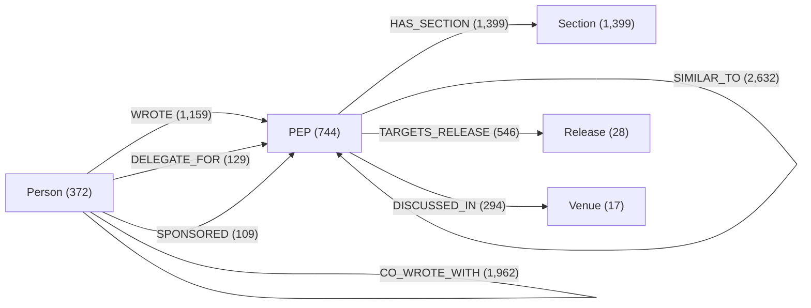

# 🧠 Company Brain on FalkorDB: Python Governance Knowledge Graph

[](https://www.falkordb.com/)
[](#)
[](https://www.python.org/)
[](LICENSE)
[](https://fastapi.tiangolo.com/)
[](https://js.cytoscape.org/)

An enterprise-grade knowledge graph and autonomous AI agent that unlocks the **entire 30-year institutional memory and governance evolution of the Python language** through 744 Python Enhancement Proposals (PEPs).

Unlike naive document search or flat Top-K vector retrieval, **Company Brain** traverses explicit relationships in **FalkorDB** to answer complex governance questions: *who made key architectural decisions, which foundational designs were abandoned or replaced, which rejected ideas were resurrected, and which active standards are orphaned.*

---

## 🚀 Live Interactive Web App: The Visual Showpiece

Launch the full interactive application with a single command:

```powershell
python -m uvicorn src.api.main:app --host 0.0.0.0 --port 8000
```
Open **[http://localhost:8000](http://localhost:8000)** in your browser.

```
┌────────────────────────────────────────────────────────────────────────────────────────────────────────┐
│  🧠 COMPANY BRAIN ON FALKORDB         [📚 Sources & Anchors (5)]  [● FalkorDB Live]  [12,529 Elements] │
├─────────────────────────────────────────────┬──────────────────────────────────────────────────────────┤
│  💬 INSTITUTIONAL CHAT (56% WIDTH)          │  🌐 VISUAL GRAPH CANVAS (TOP-RIGHT 58% HEIGHT)           │
│                                             │  [Fit] [DAG] [Organic]                   Nodes: 11       │
│  [Quick Demo Pills]:                        │  ┌─────────────────────────────────────────────────────┐ │
│  [Lineage 566] [PageRank Top 25]            │  │        (Dustin Ingram) -[WROTE]-> (PEP 566)         │ │
│  [Author Influence] [Resurfaced Ideas]      │  │                     /         \                     │ │
│  [Walrus 572]                               │  │             (PEP 426)         (PEP 345)             │ │
│                                             │  │                     \         /                     │ │
│  User: Trace packaging lineage for PEP 566  │  │                  (PEP 314)                          │ │
│                                             │  │                      |                              │ │
│  Agent:                                     │  │      (A.M. Kuchling) -[WROTE]-> (PEP 241)           │ │
│  ### Direct Short Answer                    │  └─────────────────────────────────────────────────────┘ │
│  The packaging-metadata spec originated     ├──────────────────────────────────────────────────────────┤
│  with PEP 241 and evolved through...        │  ⚡ LIVE CYPHER & EXECUTION TRACE (BOTTOM-RIGHT 42%)     │
│                                             │  Query #1 (1 rows)                        ⚡ 1.7 ms       │
│  [Evidence Table & Formatting]              │  MATCH p=(n:PEP {number: 566})-[:REPLACES*1..8]->(o:PEP) │
│                                             │  WHERE NOT (o)-[:REPLACES]->()                           │
│                                             │  RETURN [x IN nodes(p) | x.number] AS chain...           │
├─────────────────────────────────────────────┴──────────────────────────────────────────────────────────┤
│  Input: [ Ask any question...                                                      ] [ Send 🚀 ]       │
└────────────────────────────────────────────────────────────────────────────────────────────────────────┘
```

### Key UI Features:
1. **Interactive Cytoscape.js Canvas (Top Right):** Automatically renders multi-hop **hierarchical branching DAGs** for proposal lineages and force-directed clusters for co-authorship.
2. **Status Color-Coding:**
   - 🟢 **Final PEPs:** Emerald Green (`#10b981`)
   - 🟠 **Superseded PEPs:** Amber Orange (`#f59e0b`)
   - 🔴 **Withdrawn / Rejected PEPs:** Crimson Red (`#ef4444`)
   - 🟣 **Persons (Authors & Delegates):** Purple (`#8b5cf6`)
   - 🔵 **Releases:** Cyan (`#06b6d4`)
3. **Clickable Node Inspector:** Tap any node on the canvas to open a slide-out card displaying title, status, authors, created date, and a direct `🔗 Open Official Specification on peps.python.org` button.
4. **Simultaneous Cypher Trace Inspector (Bottom Right):** Displays the exact Cypher query executed against FalkorDB, row counts, and latency in milliseconds in real time.
5. **Slide-Over Sources Window:** Dedicated drawer listing canonical URLs and section heading anchors (`#abstract`, `#rationale`, `#rejection-notice`).

---

## 1. Why GraphRAG Beats Plain Vector RAG (The "Kill Test")

Standard RAG (chunking text + vector similarity + top-k retrieval) fails completely on institutional governance questions:

| Question Type | Why Plain Vector RAG Fails | How FalkorDB Graph Solves It |
|---|---|---|
| **Multi-hop Lineage (Q1)** | Lineages span sequential chains of unknown depth (e.g., Packaging Metadata `566 -> {426, 345} -> 314 -> 241`). Similarity search cannot follow sequential directed edges. | Traverses variable-length directed paths `(n)-[:REPLACES*1..8]->(o)` returning exact maximal DAG chains. |
| **Centrality & Prestige (Q2, Q4)** | Plain RAG cannot identify foundational vs deprecated proposals across 700+ documents. | Runs native graph algorithms (`algo.pageRank`, `algo.betweenness`) over citation and co-authorship networks. |
| **Global Absence Queries (Q7)** | Vector similarity can never prove an edge *does not exist* anywhere across the entire corpus. | Evaluates negative pattern predicates: `WHERE NOT ()-[:CITES\|REQUIRES]->(f)`. |
| **Temporal Cross-Checks (Q5, Q6)** | Plain chunks do not enforce date-order constraints across status boundaries. | Joins `(r:PEP {status: 'Rejected'})<-[:CITES]-(f:PEP {status: 'Final'}) WHERE f.created > r.created`. |
| **Resurfaced Ideas (Q11)** | Plain RAG cannot correlate a rejected proposal with a later accepted one authored by different people without citations. | Combines semantic vector similarity with temporal ordering and citation absence across author sets. |

---

## 2. Graph Data Model (Schema v1.1)

Every node and edge is extracted deterministically from raw PEP reStructuredText headers, explicit `:pep:` role citations, and verified semantic embeddings—**zero LLM extraction hallucinations during graph building**.



### Verified Graph Counts (12,529 Total Elements)
* **`PEP`** (744 nodes): Core proposal nodes (`number`, `title`, `status`, `created`, `type`, `url`, `content_hash`).
* **`Person`** (372 nodes): Authors, delegates, and sponsors. Normalized accent-folded keys with curated alias merging (`Seth Larson`, `Mariatta`).
* **`Section`** (1,399 nodes): High-signal sections (`abstract`, `motivation`, `rationale`, `rejection_notice`) storing text anchors and 768-dim embeddings.
* **`Release`** (28 nodes): Target Python versions (e.g. `3.8`, `3.12`), normalized to `major.minor`.
* **`Venue`** (17 nodes): Discussion channels (`discuss.python.org`, mailing lists such as `distutils-sig@python.org`).
* **10 Relationships**: `WROTE` (1,159), `REPLACES` (46), `CITES` (1,653), `HAS_SECTION` (1,399), `DELEGATE_FOR` (129), `SPONSORED` (109), `REQUIRES` (40), `TARGETS_RELEASE` (546), `DISCUSSED_IN` (294), `CO_WROTE_WITH` (1,962), `SIMILAR_TO` (2,632).

---

## 3. Autonomous Multi-Tiered AI Agent

Rather than risking hallucinated Cypher or relying on a rigid question router, the Company Brain agent employs a robust **3-tiered execution hierarchy**:

1. **Tier 1: Validated Recipes**
   * Pre-compiled, verified parameterized Cypher queries answering the 11 Golden Governance Questions (plus 6 Held-out questions). Zero syntax errors, mathematically verified against NetworkX ground truth.
2. **Tier 2: Composable Graph Primitives**
   * Atomic operations (`search_peps` with hybrid vector + full-text, `get_pep_details`, `get_pep_sections`, `traverse_graph`, `find_shortest_path`, `check_relationship_absence`) chained dynamically by the agent planner for open-ended queries.
3. **Tier 3: Guarded Read-Only Cypher**
   * Sandboxed Cypher interpreter with regex safeguards (`NO WRITES`), strict timeout, and transparent UI labelling: *"⚠️ Executed via unvalidated ad-hoc query"*.

### Embedding & Agent Models
| Capability | Model | Role in Company Brain | Status |
|---|---|---|---|
| **Embeddings** | **`BAAI/bge-base-en-v1.5`** (via FastEmbed) | Generates 768-dimensional normalized vectors locally with GPU acceleration at zero API cost. Indexed with FalkorDB Cosine Vector Index on `:Section(embedding)`. | **Live** |
| **Primary Agent Loop** | **`gemini-3.5-flash-lite`** | High-throughput, low-latency ReAct agent loop for intent planning, tool invocation, and grounded synthesis with automatic multi-model failover. | **Live** |
| **Deep Reasoning** | **`gemini-3.8-flash`** | High-capacity reasoning engine reserved for complex discrepancy resolution. | **Verified** |

---

## 4. System Prerequisites & End-to-End Setup Guide

Follow this guide to clone, configure, build, and run **Company Brain** on your local machine from scratch.

### 4.1 System Prerequisites & Compatibility

Before starting, ensure your system meets the following specifications:

| Requirement | Minimum / Recommended Version | Purpose & Verification Command |
|---|---|---|
| **Operating System** | Windows 10/11 (64-bit) with WSL2, Ubuntu 20.04+, or macOS 12+ | Host platform for Docker and Python runtime |
| **WSL 2 (Windows only)** | WSL 2 with Ubuntu / default Linux kernel | Required by Docker Desktop on Windows. Verify: `wsl --status` |
| **Docker & Docker Compose** | Docker Desktop 4.25+ or Docker Engine 24.0+ with Compose v2 | Runs containerized FalkorDB instance. Verify: `docker --version` & `docker compose version` |
| **Python** | **Python 3.12 (64-bit)** | Core runtime for parser, agent, and API server. Verify: `python --version` |
| **Hardware / Accelerator** | NVIDIA GPU (e.g., RTX 3050, 6GB VRAM) or Multi-core CPU | GPU accelerates FastEmbed (`bge-base-en-v1.5`). *If no GPU is present, FastEmbed runs on CPU automatically with zero code changes.* |
| **Google AI Studio API Key** | Free Tier Gemini API Key | Powers the autonomous agent reasoning loop. Free tier grants 1,500 req/day for `gemini-3.5-flash-lite`. Get key at [aistudio.google.com](https://aistudio.google.com/). |
| **Git** | Git 2.30+ | Repository version control. Verify: `git --version` |

> [!NOTE]
> **Windows Users (WSL 2 & Docker Desktop):**
> 1. Ensure WSL 2 is installed by running `wsl --install` in an Administrator PowerShell, then reboot if prompted.
> 2. In **Docker Desktop Settings ➔ General**, make sure **"Use the WSL 2 based engine"** is checked.
> 3. Under **Settings ➔ Resources ➔ WSL Integration**, enable integration with your default distro.

---

### 4.2 Step-by-Step Installation Flow

#### Step 1: Clone the Repository
```powershell
git clone https://github.com/adityasarate/graph-hacks.git
cd "Graph hacks"
```

#### Step 2: Set Up Python 3.12 Virtual Environment

**On Windows (PowerShell):**
```powershell
# Create virtual environment with Python 3.12
python -m venv .venv

# If PowerShell displays an ExecutionPolicy error, run:
Set-ExecutionPolicy -Scope Process -ExecutionPolicy Bypass

# Activate the environment
.\.venv\Scripts\Activate.ps1
```

**On Linux / macOS (Bash):**
```bash
python3 -m venv .venv
source .venv/bin/activate
```

#### Step 3: Install Dependencies
```powershell
python -m pip install --upgrade pip
pip install -r requirements.txt
```
*(Installs `falkordb`, `fastembed`, `google-genai`, `fastapi`, `uvicorn`, `networkx`, `scikit-learn`, `python-dotenv`, and dependencies).*

#### Step 4: Configure Environment Variables
Create a `.env` file in the project root:

```powershell
# You can copy the example configuration:
Copy-Item .env.example .env   # On Windows
# or: cp .env.example .env    # On Linux/macOS
```

Ensure `.env` contains:
```env
# FalkorDB Database Configuration
FALKORDB_HOST=localhost
FALKORDB_PORT=6379
FALKORDB_GRAPH=hackathon_brain

# Google Gemini Agent Configuration
GEMINI_API_KEY=your_google_ai_studio_api_key_here
GEMINI_MODEL=gemini-3.5-flash-lite
```

#### Step 5: Start FalkorDB via Docker
Launch the official FalkorDB container in the background:
```powershell
docker compose up -d
```

Verify that the container is running and healthy:
```powershell
docker compose ps
```
You should see:
- `falkordb` container in state `Up` (healthy)
- Port `6379` open for the FalkorDB Cypher/Redis protocol
- Port `3000` open for the FalkorDB Web Browser GUI (`http://localhost:3000`)

To test the raw connection:
```powershell
python -c "import redis; r = redis.Redis(host='localhost', port=6379); print('FalkorDB Ping:', r.ping())"
# Output should be: FalkorDB Ping: True
```

#### Step 6: Ingest Knowledge Graph & Build Indexes
Execute the deterministic Schema v1.1 loader:
```powershell
python src/graph/load.py
```
What this step does automatically:
1. Creates FalkorDB **Range Indexes** on `PEP.number`, `Person.key`, `Section.id`, `Release.version`, and `Venue.name`.
2. Creates a **Full-Text Index** on `PEP.title`.
3. Creates a 768-dimensional **Cosine Vector Index** on `Section.embedding`.
4. Parses all 744 raw PEP documents and loads the 1,399 section embeddings (from `data/embeddings_cache_bge_768.pkl` in ~2 seconds, or computes them locally via FastEmbed).
5. Materializes all 12,529 nodes and relationships in fast parameterized batches.

---

### 4.3 Comprehensive Verification Suites

Run the 4 automated audit suites to ensure complete integrity across data, queries, agent, and API:

```powershell
# 1. Audit Database Parity (15 Entity Sets):
python eval/check_counts.py
# 100% exact match across all 12,529 nodes and relationships!

# 2. Audit All 19 Golden Governance Questions (Q1-Q13 + Held-out H1-H6):
python eval/test_golden_questions.py
# 19/19 queries pass with 100% pre-validated ground truth match!

# 3. Audit Autonomous Multi-Tier Agent Loop:
python eval/test_agent.py
# 5/5 agent evaluation tests passed!

# 4. Audit FastAPI Backend Service & Static Assets:
python eval/test_api.py
# 5/5 API endpoint & asset tests passed!
```

---

### 4.4 Launch the Interactive Web Application

Start the live FastAPI server:
```powershell
python -m uvicorn src.api.main:app --host 0.0.0.0 --port 8000
```
Open **[http://localhost:8000](http://localhost:8000)** in any modern web browser to interact with the Python Governance Brain!

---

### 4.5 Troubleshooting & Common Pitfalls

| Issue | Cause | Solution |
|---|---|---|
| `docker compose up` fails with *daemon not running* | Docker Desktop is closed or WSL2 backend is not running | Open Docker Desktop, wait for the engine icon to turn green, then re-run `docker compose up -d`. |
| `redis.exceptions.ConnectionError: Error 10061 connecting to localhost:6379` | FalkorDB container is not running | Run `docker compose up -d` and verify with `docker ps`. Ensure port `6379` is not bound by an existing Redis service. |
| `Port 6379 is already allocated` | Another local Redis instance is using port 6379 | Stop the conflicting local Redis service or map another host port in `docker-compose.yml` (e.g. `6380:6379`) and set `FALKORDB_PORT=6380` in `.env`. |
| PowerShell: *File Activate.ps1 cannot be loaded because running scripts is disabled* | PowerShell Execution Policy restriction | Run `Set-ExecutionPolicy -Scope Process -ExecutionPolicy Bypass` in the current terminal window before activating `.venv`. |
| `429 RESOURCE_EXHAUSTED` from Gemini API | Google AI Studio free tier requests exceeded on higher-tier models | The project uses `gemini-3.5-flash-lite` by default (1,500 daily requests limit). Ensure `GEMINI_MODEL=gemini-3.5-flash-lite` is set in `.env`. The agent core also has automatic fallback to `gemini-flash-latest`. |
| `ModuleNotFoundError: No module named 'dotenv'` | Python command was executed outside the active virtual environment | Activate the virtual environment (`.\.venv\Scripts\Activate.ps1` or `source .venv/bin/activate`) or run directly via `.\.venv\Scripts\python <script.py>`. |

---

## 5. Repository Structure

```
.
├── docker-compose.yml          # FalkorDB container configuration
├── requirements.txt            # Project dependencies (falkordb, fastembed, google-genai, fastapi)
├── README.md                   # Master project documentation
├── walkthrough.md              # Illustrated, beginner-friendly story of the project
├── docs/                       # Formal architecture and governance specifications
│   ├── Company_Brain.md        # Single source of truth master specification
│   ├── DECISIONS.md            # Architecture and design decision log (D1–D31)
│   ├── DATA_MANIFEST.md        # PEP dataset metrics and provenance
│   └── AI_ASSISTANCE.md        # Hackathon AI assistance disclosure and audit log
├── data/
│   ├── peps/                   # Snapshot of python/peps (744 PEP documents)
│   ├── embeddings_cache_bge_768.pkl   # Local BGE embeddings cache (1,399 vectors)
│   └── embeddings_cache_gemini_768.pkl# Archived Gemini embeddings
├── eval/
│   ├── check_counts.py         # Count audit against expected counts
│   ├── expected_counts.json    # Target numbers for all 15 entity sets
│   ├── test_golden_questions.py# Golden questions (Q1–Q13, H1–H6) verification harness
│   ├── test_agent.py           # End-to-end agent evaluation harness
│   └── test_api.py             # FastAPI backend test suite
├── src/
│   ├── graph/
│   │   ├── parse.py            # High-performance PEP rST parser (0.35s)
│   │   └── load.py             # FalkorDB batch loader with indexes & embeddings
│   ├── core/
│   │   └── logger.py           # Structured TraceLogger (JSONL traces & subgraphs)
│   ├── agent/
│   │   ├── tools.py            # 3-Tier Toolset (Recipes, Primitives, Guarded Cypher)
│   │   ├── prompts.py          # System prompt and governance instructions
│   │   └── core.py             # ReAct execution engine with Gemini & failover
│   └── api/
│       ├── main.py             # FastAPI service (/api/chat, /api/graph/stats)
│       └── static/             # Interactive frontend (index.html, style.css, app.js)
└── logs/
    └── traces/                 # Structured JSON traces with subgraphs and latencies
```

---

## 6. Project Roadmap & Completion Status

- [x] **Phase 1: Graph Design & Verification**
  - [x] Formulated Schema v1.1 (PEPs, Persons, Sections, Releases, Venues)
  - [x] Verified FalkorDB Cypher Gotchas (G1–G14)
- [x] **Phase 2: Ingestion & Graph Construction**
  - [x] Implemented deterministic Schema v1.1 loader with alias tables
  - [x] Embedded 1,399 Section nodes using `BAAI/bge-base-en-v1.5` (768-dim) on RTX 3050 GPU
  - [x] Built Range, Full-Text, and Cosine Vector Indexes
  - [x] Audited 100% parity across all 12,529 entities in FalkorDB
- [x] **Phase 3: Autonomous Agent Implementation**
  - [x] Built Tier 1 Validated Recipes & Tier 2 Composable Primitives
  - [x] Implemented Guarded Read-Only Cypher Runner (Tier 3)
  - [x] Built ReAct loop using `gemini-3.5-flash-lite` with automatic model failover
  - [x] Integrated structured JSON trace logging (`src/core/logger.py`)
- [x] **Phase 4: API Backend Service**
  - [x] Built FastAPI service exposing `/api/chat`, `/api/graph/stats`, and `/api/traces`
- [x] **Phase 5: Interactive Web App & Visual Showpiece**
  - [x] Built split-screen interface with expanded chat (56% width)
  - [x] Implemented Cytoscape.js DAG branching layout for lineages
  - [x] Integrated simultaneous live Cypher query & latency inspector
  - [x] Built clickable node inspector drawer with links to `peps.python.org`
  - [x] Built slide-over Sources & Citations window
- [x] **Final Delivery & Hackathon Evaluation**
  - [x] Passed all 19 Golden Governance Questions
  - [x] Passed all Agent Evaluation Tests (5/5)
  - [x] Passed all API Service Tests (5/5)

---

## 7. License
Distributed under the MIT License. See `LICENSE` for details.
