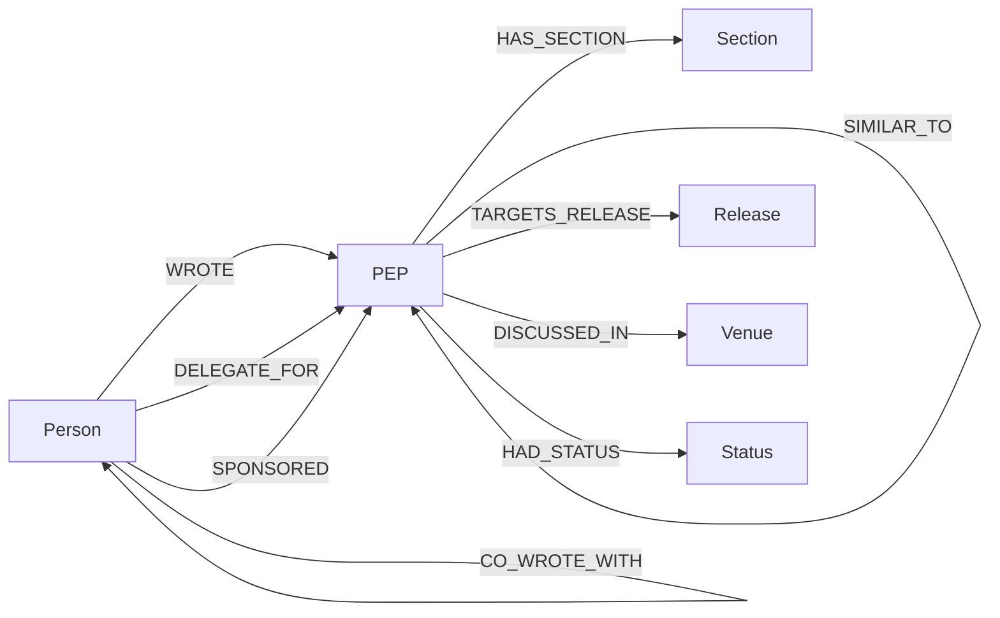

# Company Brain on FalkorDB: Master Document

Version 1.1, revised Friday 16 October 2026. Status: **Schema v1.1 is the working design. It freezes when the Gate G checks in section 15.4 pass. The agent and the build have not started.** This document is the single source of truth. If it conflicts with any earlier note, this document wins.


Items deliberately postponed (entity resolution beyond aliases, more source types, access control, scale and latency, agent runtime and safety, answer-quality evaluation and observability) are tracked in the companion Word file Company_Brain_Deferred_Items_Tracker.docx.


## 0. Read this first

### 0.1 Purpose

This document records every decision, measurement, caveat and open item from the design of a knowledge graph for a hackathon project. It is written so that a reader with **no prior context** can understand the project, judge the design, and find what is missing or wrong.

### 0.2 Evidence legend


Every factual claim carries one of these grades, either on the line or in its section header.

| Grade | Meaning |
| --- | --- |
| **Run** | The author ran it and compared the result with an independent calculation |
| **Run (reviewer)** | Executed by a second, independent review session on 16 October 2026, using its own parser and loader against the python/peps repository at HEAD `6101cc9` (2026-10-15), one day newer than the snapshot, on falkordblite 0.10.0. Counts can differ by few units from the snapshot |
| **Docs** | Read in official documentation, not executed |
| **Inference** | Reasoned from the evidence above, not directly checked |
| **Unverified** | Stated as a belief or a plan. Treat with suspicion |

### 0.3 Instructions for a reviewing model

You are reviewing this design cold. Do not rewrite it. Do the following and report in this order.

1. **Restate** the project and the design in at most ten lines, to prove you understood it.
2. **Find inconsistencies**: numbers, names or definitions that disagree between sections.
3. **Find gaps against the hackathon requirements** in section 2.
4. **Challenge the schema** (section 7): missing node or link types, risky properties, anything that would break the agent, anything that fails the "kill test" (the product must not work if the graph database is removed).  
5. **Challenge the questions** (section 5): is each one truly a graph question that plain top-k retrieval cannot answer? which are weak?
6. **Challenge the validation** (section 9): what it does not cover, and whether the independent checks are truly independent.
7. **Review the open items** (section 12): is anything missing, mis-prioritised or understated?
8. **Check the schedule** (sections 2.5 and 15) for realism.
9. **Output**: a prioritised list. For each item give a severity (blocker, major or minor), the evidence from this document, and a recommended fix. End with the questions you would ask the author.

Treat anything graded **Inference** or **Unverified** as a claim to test, not a fact.

### 0.4 What changed in version 1.1

Version 1.1 follows a second, independent review. Where the reviewer ran code the grade is **Run (reviewer)**. The reference code is in section 16. Nothing validated in v1.0 was removed, except where noted.

| # | Change | Why | Sections |
| --- | --- | --- | --- |
| 1 | Q1 is a two-route graph, not a straight chain | PEP 566 declares that it replaces 345, and also replaces 426, which itself replaces 345 | 5, 8, 13 |
| 2 | 582 Q3 excludes self-citation by default | 51 of Guido van Rossum's 233 citations come from his own PEPs | 5,8 |
| 3 | Q7 is redefined, giving 46 instead of 71 | 15 of the 71 are release schedules and 10 are other Informational or Process PEPs | 5,8 |
| 4 | Delegate facts corrected | 130 PEPs name a delegate (83 `BDFL Delegate`, 47 `PEP-Delegate`), not 47 | 4, 11 |
| 5 | Schema v1.1 adds type, `DELEGATE_FOR`, `SPONSORED`, `REQUIRES`, `Release`, `Venue` and designs `HAD_STATUS` | Track 3 asks who decides, what was targeted where, and where discussion happened. All of it is stated in headers | 7 |
| 6 | Status history is recoverable from git | Recovered for all 15 PEPs sampled. A full run is not done | 7.6 |
| 7 | Incremental ingest designed and tested | A real 26-file delta applied incrementally equals a fresh build | 7.9 |
| 8 | Held-out questions added | The schema was derived from, and validated on, the same questions | 5.2 |
| 9 | New FalkorDB gotchas G11 to G14 | `shortestPath` limits, betweenness scale, algorithm list | 10 |
| 10 | Agent direction changed from one tool per question to tiered tools | A router over eleven queries cannot answer an unseen question | 14 |
| 11 | Postponed items moved to a tracker | Keeps this document about the graph | Word tracker |

Timing rule (section 2.3), reviewer confirmation: the event window opened on 15 October at 12:01 AM IST. The prototype bundle is not yet in a public repository, so no commit history can show when the work happened. Create the repository, commit the prototype with the AI-assistance disclosure, and keep every later change in commits (Gate G, item G9).

What the reviewer could not verify is listed in section 9.4.

---

## 1. The project in brief

**Goal.** Build a "Company Brain": an AI agent that answers questions about how an organization's decisions were made, who made them and what changed, by walking a knowledge graph stored in FalkorDB. Every answer shows the path through the graph and the sources behind it.

**The organization.** The Python project and its public design process, recorded as Python Enhancement Proposals (PEPs). A PEP is a written proposal through which a change to Python is decided. It has authors, a status (Final, Rejected, Withdrawn and so on), links to PEPs it replaced, and text explaining the reasoning.

**Persona asking.** A developer or new maintainer who wants to understand how Python's design decisions were made.

**Approach.** GraphRAG: retrieval that follows explicit relationships in a graph, instead of only matching similar text. Text similarity (embeddings) is used as one signal inside the graph, not as the whole system.

**Scope boundaries (what this is not).**

- No code ownership, commits or reviews. Only the PEP documents are modelled.
- No status history in the PEP headers, which hold only the current status. History is recoverable from the repository's git log (section 7.6) and is recorded going forward by incremental ingest (section 7.9). Until it is built the agent must say that no history is available.
- Discussion content is not modelled. Only the venue (forum or mailing list) and the thread URL stated in the PEP header are modelled.
- Not a general chatbot over documents.

---

## 2. Context and constraints

### 2.1 The hackathon (Docs, read from the event pages)

| Item | Detail |
| --- | --- |
| Event | Graph Hacks: Context for AI Agents, by WeMakeDevs with FalkorDB |
| Window | 15 Oct 2026 12:01 AM IST to 18 Oct 2026 11:59 PM IST |
| Prizes | $20,000: one prize per track, a best blog post prize, and t-shirts for the top 50 teams |
| Tracks | 1: Agents That Act on Connected Data. 2: Agent Memory and Coordination. 3: Company Brain |
| This project | Headline track is Track 3. Tracks 1 and 2 are not targeted in v1 |
| Team | Solo, one person |
| Judging rubric | **Not published.** Any statement about scoring is Inference |

### 2.2 Submission requirements (Docs)

1. Public source repository
2. README with setup instructions **and the graph data model**
3. The Cypher queries or graph algorithms the product depends on
4. Demo video of the working project
5. Live deployment, or complete local setup instructions plus a working demo video
6. The track or tracks named at submission

### 2.3 Rules that shape the design (Docs)

| Rule | Consequence here |
| --- | --- |
| FalkorDB must be the primary graph database and central to the product. If the product still works without it, the graph is decoration and does not qualify | Every golden question is answered by a graph query or algorithm, and a baseline comparison is planned |
| Only public, synthetic or the participant's own data | PEPs are public, and 711 of 744 state CC0 or public domain in their text (heuristic scan) |
| AI coding assistants are allowed but must be disclosed, and the participant must be able to explain the graph model, queries and architecture | A disclosure section is needed in the README, and an AI-assistance log should be kept |
| Main design and coding must start after the event begins. Notes and sketches before are fine | All code was written during the design sessions, which fall inside the event window (the date at the time of writing is 16 October 2026). Author and reviewer: confirm this against the rule |
| New work only | Nothing reused from an earlier project |

### 2.4 Author constraints

120

|Item | Detail |
| --- | --- |
| Builder | Solo, comfortable in Python, has built RAG and agents but not always end to end |
| LLM and embedding access | A Google AI Pro subscription. This does not include API calls (Docs). A free Google AI Studio API key may allow embeddings within free-tier limits (Docs, not yet tested on this account) |
| Infrastructure | No Google Cloud project |

### 2.5 Schedule status (Inference)

- Original plan: Phase 1 complete on Day 1 (15 Oct). Actual: Phase 1 is complete as of 16 Oct (Day 2). Roughly half a day behind, though the exact time of day was not tracked.
- Remaining window: from 16 Oct to 18 Oct 11:59 PM IST. Target submission is about 6 PM IST on 18 Oct.
- A compressed plan is in section 15. Version 1.1 adds about 5 hours of work (section 15.3) and leaves no slack.

---

## 3. Architecture and where each technology is used

```
python/peps repository ──parse──> loader (Python) ──> FalkorDB graph
        |                              |                   |
        | changed files since          embeddings (S1)     ├── Cypher queries and algorithms
        | the manifest commit                              ▼
        └──> incremental ingest (7.9)             agent tools (tiered, section 14)
                                                           ▼
                           LLM plans, calls tools, verifies, then answers, acts or abstains
                                                           ▼
                                      UI: answer + path + source links + trace
```

| Component | Role | Status |
| --- | --- | --- |
| Loader | Reads PEP files, builds nodes and links, and applies incremental updates | Author prototype exists (section 16). A v1.1 reference loader with incremental ingest was run by the reviewer (7.9) |
| FalkorDB | Stores the graph, runs queries, PageRank, betweenness, connected components, label propagation, vector search, full-text search | Tested on the embedded `falkordblite` 0.10.0 by the author and the reviewer. A server is not tested |
| Embedding model | Turns Section text into vectors | Not chosen (S1). Stand-in used |
| Agent and tools | Plans, calls graph tools, verifies, then answers, acts or abstains | **Direction agreed, design deferred** (section 14) |
| UI | Shows answer, path and sources | **Not designed yet** |

**The LLM is not used to build the graph.** Every node and link comes from headers, text patterns, embeddings or graph algorithms. The LLM appears only at answer time.

---

## 4. The dataset (Run unless stated)

Source: `https://github.com/python/peps`, folder `peps/`. Snapshot used for all validation: commit `b80c7bf8d5a89fc47b732504a9e1219b79677531`, dated 2026-10-14.

| Fact | Value |
| --- | --- |
| PEP source files parsed | 744 |
| Title, Status, Created, Author headers | Present on all 744 |
| Resolution link | 259 PEPs |
| Replaces header/Superseded-By header | 35/31 PEPs (46 distinct replacement links combined) |
| PEP-to-PEP citations in body text (`:pep:` role) | 1,653 distinct links (106 self-references skipped) |
| Section coverage (non-trivial text) | Abstract 686, Motivation 283, Rationale 377, Rejection notice 53 |
| PEPs with at least one of abstract, motivation, rationale | 707 |
| PEPs with none of the four section kinds | 32 |
| Authors | 373 raw strings, 372 after accent folding, 370 after removing two non-person strings |
| Licence statements in text | 249 CCO, 462 public domain, 33 unclear (heuristic text scan) |
| Statuses | Final 375, Rejected 132, Withdrawn 72, Draft 55, Active 37, Deferred 36, Superseded 25, Accepted 11, Provisional 1 |
| Date range | 1996 to 2026, all 744 dates parse |
| Size | About 20 MB of files, about 14 MB of body text |

### Header coverage added in version 1.1 (Run reviewer)

Counted from the headers at repository HEAD `6101cc9`. The author’s snapshot `b80c7bf` is one day older.

| Header | PEPs | Notes |
| --- | --- | --- |
| `Type` | 744 | Standards Track 587, Informational 104, Process 53. Final PEPs: 308 Standards Track, 51 Informational, 16 Process |
| `Python-Version` | 528 | 38 distinct strings. Multi-valued (“2.6, 3.0”) and sometimes patch levels (“2.7.9, 3.4.3, 3.5”) |
| `Discussions-To` | 295 | 199 are `discuss.python.org` thread URLS, 8 are `mail.python.org` archive URLs, the rest are mailing-list addresses such as `distutils-sig@python.org` (26). 294 parse to a venue. One was not investigated |
| `Sponsor` | 109 | 109 person links |
| `BDFL-Delegate` | 83 | Older name for the same role as `PEP-Delegate` ( Inference) |
| `PEP-Delegate` | 47 | No PEP has both headers. 138 PEPs have one of the two. After excluding group names such as the C API Working Group, 129 delegate links point to people |
| `Requires` | 28 | 40 links. No Final PEP requires a non-Final PEP (Run reviewer) |
| `Post-History` | 473 non-empty | Not modelled |

Delegates skew towards accepted work: 78 of 375 Final PEPs name one, but only 12 of 132 Rejected PEPs do. "who approved this" is answerable for some Final PEPs. "Who rejected this" mostly is not, which agrees with dropping that question. The most frequent delegates are Paul Moore (25 PEPs), Alyssa Coghlan (22), Donald Stufft (15), Brett Cannon (10) and Guido van Rossum (9), counting both headers (Run reviewer).

### Known limitations of the data

- No status history in the headers. It is recoverable from git (section 7.6) and recorded going forward by incremental ingest (section 7.9).
- The reason for a rejection exists only for some PEPs (see Q8 coverage).
- The 202 Replacement data is Inconsistent between the two headers: 27 links appear in both, 14 only in the new PEP, 5 only in the old PEP.
- One PEP has a joke status ("April Fool!"). It is mapped to Rejected, which matches the official PEP API.
- One PEP (13, Python Language Governance) has an organization as author and therefore no person link.
- Single-name authors (Talin, Mariatta, Aahz: 11 WROTE links) are real people. A cleaning rule that requires two name parts drops them. The author's 1,159 WROTE links equal the reviewer's count once these are kept (Run reviewer).
- `Seth Larson` and `Seth Michael Larson` are one person (3 PEPs), and the sponsor `Mariatta Wijaya` is the author Mariatta. Both go into the alias table (D23). Other same-surname pairs found (Joshua and Brett Cannon, Just and Guido van Rossum, Marina and Paul Moore, several Smiths) look like different people (Inference). 
- Some names in `Sponsor` and `delegate` headers are not people (`TODO`, `C API Working Group`) and must be excluded.
- `mail.python.org` archive URLs are mailing-list archives, not forums. The venue rule must classify them as mailing lists.
- Discussion threads are external links. Whether they can be fetched was not checked (Unverified).

### Uniqueness risk (Inference)

PEPs are a niche dataset, but the author cannot see what other participants chose. Famous PEPs are in LLM training data, so a plain chatbot can answer simple questions about them. The questions in section 5 were chosen to need counting, ranking, chains and absence checks that memory cannot do reliably.

---

## 5. The eleven golden questions

Test applied to each: plain top-k chunk retrieval should fail because the answer needs a ranking across all documents, a chain of unknown length, a reverse lookup, a structural measure, or a cross-check of fields.

"Ready answer" means an answer computed from the real data and checked against an independent Python calculation. Answers for questions 9 to 11 use stand-in embeddings and **will change**.

| # | Question | Why top-k retrieval fails | Ready answer |
| --- | --- | --- | --- |
| 1 | Trace the replacement history of the packaging-metadata spec, with authors | Chain of unknown length | 241 (Kuchling), 314 (Kuchling, Jones), 345 (Jones), then two routes to 566 (Ingram; Final): directly, because 566 declares that it replaces 345, and through 426 (Coghlan, Holth, Stufft; withdrawn). Maximal chains: 566, 426, 345, 314, 241 and 566, 345, 314, 241 (Run reviewer). The answer and the UI must show a graph with two routes, not a line |
| 2 | which highly foundational PEPs are no longer current? | Centrality plus status | Non-Current PEPs in the PageRank top 25: 241, 345, 426 |
| 3 | Whose work do other PEPs build on most, in total and per PEP? | Reverse lookup plus ranking | v1.0, all citations: Guido van Rossum 233, Alyssa Coghlan 186, Barry Warsaw 120. Distinct citing PEPs: Guido 154, Alyssa 143, Barry 108. **v1.1 default, excluding citations from PEPs the same person wrote**: Guido 182 (131 distinct citing PEPs), Alyssa 143 (114), Barry 92 (86), Brett Cannon 86 (73), Donald Stufft 85 (56). The Cypher equals an Independent Python calculation (Run reviewer). The order of the top three is unchanged. 51 of Guldo’s 233 and 43 of Alyssa’s 186 were self-citation. Per-PEP averages (v1.0: Daniel Holth 7.7, Ivan Levkivskyi 5.9, tukasz Langa 5.8) must be recomputed under the v1.1 definition |
| 4 | which authors bridge otherwise separate groups of co-authors? | Structural measure | Top six, averaged over 5 fixed seeds: Guido van Rossum first, then Pablo Galindo Salgado, Donald Stufft, Barry Warsaw, Brett Cannon, Alyssa Coghlan. The exact calculation gives the same six in the order Guido, Pablo, Brett, Donald, Barry, Alyssa |
| 5 | which rejected PEPs were later cited by newer Final PEPs? | Multi-hop with time | 33 PEPs (exact-date rule). Four are each cited by 3 later Final PEPs: 340, 637, 325, 262 |
| 6 | which authors with mostly rejected or withdrawn work still had it cited by later Final PEPs? | Two-hop path with filtering and aggregation | Jeroen Demeyer (575, 580), Skip Montanaro (266, 304), Moshe Zadka (228, 239), Tarek Ziadé (381), Gregory Ewing (3152) |
| 7 | Which Final Standards Track PEPs were never built on (neither cited nor required)? | Absence across all documents | v1.0: 71 of 375 Final PEPs have no incoming `CITES`. **v1.1 default: 46**. The 71 included 15 release-schedule PEPs and 10 other Informational or Process PEPs. Cypher equals Python (Run reviewer). “Never cited” means not cited through the `:pep:` role (limitation L1) |
| 8 | what reason is stated for rejected PEPs that were later cited, when one exists? | Graph picks the PEPs, text explains | Of the 33: 17 have a rejection notice, 8 have a resolution link, 24 have at least one, 9 have neither |
| 9 | Which replacements changed least, and which most? | Graph picks pairs, embeddings score them | **Stand-in.** 41 of 46 pairs scorable. Closest: 333 and 3333, 247 and 452, 543 and 748. Furthest by an earlier full-text measure: 291 and 387, 245 and 443 |
| 10 | Which PEPs have very similar content but never reference each other? Absence of a link combined with similarity | **Stand-in.** 31 pairs at a score of 0.8 or more, after excluding templated release-schedule PEPs |
| 11 | which rejected ideas resurfaced in later accepted PEPs, and who wrote both? | Similarity, time, absence of a link, two sets of authors | **Stand-in.** 4 pairs at 0.8 or more. Examples: 332 (Skip Montanaro) and 358 (Guido van Rossum, Neil Schemenauer); 377 (Alyssa Coghlan) and 479 (Guido van Rossum, Chris Angelico) |

### Honest assessment of question strength (Inference)

- Strongest as “graph beats retrieval”: 1, 2, 3, 4, 5, 6, 7.
- Questions 8 to 11 depend on text or embeddings and are only as good as that data. Question 8 has no stated reason for 9 of 33 PEPs, and the agent must say so.
- Counting and ranking questions by a single field were deliberately dropped because a spreadsheet can answer them. Q9 is the exception that survived: it sorts a precomputed property, so it is the weakest of the eleven a graph question.
- Q3 and Q7 changed definition in v1.1 (section 0.4). Questions 12 to 14 and the held-out set are new (sections 5.1 and 5.2).

### Questions considered and dropped 244

| Idea | Reason |
| --- | --- |
| Which authors wrote the most Informational PEPs | Single-field count, proves nothing about the graph |
| Authors whose PEPs were Accepted, then Withdrawn | No status history in the headers. Possible in v1.1 once `HAD_STATUS` is built (question 14) |
| By whom was a PEP rejected | Rarely recorded. 12 of 132 Rejected PEPs name a delegate, against 78 of 375 Final PEPs (130 PEPs in all) |
| Final or Accepted PEPs that require a rejected PEP | Zero results (Run) |
| Everything downstream of a PEP through references | Too broad: 424 of 744 PEPs connect to PEP 5 (Run) |
| Why a replacement PEP was not needed | A judgment the data cannot prove. Replaced by question 9 |

### 5.1 New questions enabled by schema v1.1

| # | Question | Why top-k retrieval fails | Status |
| --- | --- | --- | --- |
| 12| which delegates decided PEPs that were later superseded? | Role link plus status, grouped by person | Run reviewer: Alyssa Coghlan (571, 513), Paul Moore (599), Richard Jones (438), Barry Warsaw (431). Cypher equals Python |
| 13 | Which Final PEPs targeted Python 3.8?| Reverse lookup through a release node | Run reviewer: 11, of which one is the release-schedule PEP 569 (10 without it). `Python-Version` is the target release, not a verified ship date |
| 14 | which PEPs moved from Accepted to withdrawn, and how long did Draft to Final take? | Needs status history | **Unverified.** Depends on `HAD_STATUS` (section 7.6), which is not built |
 
### 5.2 Held-out questions

These were not used to design the schema, so they test whether the design generalises. Run them before the freeze (Gate G6). If the graph cannot answer one, record a design gap. Do not edit the question to fit.

| # | Question | Result (Run reviewer unless stated) |
| --- | --- | --- |
| H1 | which people both wrote PEPs and acted as delegate? | 28 people. Cypher equals Python. 3 delegates sponsors never authored a PEP |
| H2 | what is the shortest citation route from one PEP to another? | PEP 484 cites PEP 3107 directly (1 hop). The tool must try both directions, because undirected `shortestPath` is not supported (G11) |
| H3 | which venues carry the most PEPs, and what share became Final? | discuss.python.org 199 PEPs (89 Final), distutils-sig 26 (12), python-dev 21 (14), typing-sig 9 (9), mail.python.org archives 9 (7). Cypher equals Python |
| H4 | who sponsored PEPs that were Rejected or withdrawn? | Brett Cannon 3, Jelle Zijlstra 3, Guido van Rossum 2, Barry Warsaw 2. Cypher equals Python |
| H5 | What clusters exist in citation graph | `algo.MCC` gives 90 components and `algo.label Propagation` 148 communities over the PEP nodes. Both run. Their meaning (isolated 16 PEPs count as components) was not interpreted |
| H6 | which non-Final PEPs are required by Final PEPs | Zero rows (Cypher equals Python). A useful absence check, a weak headline question |

## 6. Paths followed by each question

| # | Path |
| --- | --- |
| 1 | PEP, then replaces links repeated until none are left (keep only chains that end at a root), then each PEP's authors |
| 2 | All cites links, PageRank, then filter by status |
| 3 | Person, wrote, PEP, cited by a PEP that this person did not write. Count received and count distinct citing PEPs, and divide by the number of PEPs 
| 4 | Person to person when they co-wrote a PEP, then betweenness |
| 5 | Rejected PEP, cited by a Final PEP created later |
| 6 | Person, wrote, PEP with status Rejected or Withdrawn, cited by a later Final PEP, counted per autho
| 7 | Final Standards Track PEP with no incoming cites requires link |
| 8 | Result of question 5, then the rejection-notice Section and the resolution link of each PEP |
| 9 | Each replaces link, then compare the text of both PEPs|
| 10 | Pairs of similar PEPs with no cites or replaces path of 1 or 2 steps between them, excluding templated PEPs |
| 11 | Rejected PEP similar to a later Final PEP with no cites link, then both PEPs authors |
| 12 | Person, delegate for, PEP with status Superseded, grouped by person |
| 13 | PEP with status Final, targets release, Release 3.8 |
| 14 | PEP, had status Accepted, then had status Withdrawn, with dates (needs `HAD_STATUS`) |

---

## 7. Schema v1.1 (working design, freezes at Gate G)

### 7.1 Diagram



Text form: Person -WROTE-> PEP. Person -DELEGATE_FOR-> PEP (the person decided, as delegate). Person -SPONSORED-> PEP. PEP -HAS_SECTION-> Section. PEP -REPLACES-> PEP (new to old). PEP -CITES-> PEP (citing to cited). PEP -REQUIRES-> PEP (dependent to required). PEP -SIMILAR_TO-> PEP (lower number first). PEP -TARGETS_RELEASE-> Release. PEP -DISCUSSED_IN-> Venue. PEP -HAD_STATUS-> Status (proposed, not built). Person -CO_WROTE_WITH- Person (stored in both directions). New in v1.1: DELEGATE_FOR, SPONSORED, REQUIRES, TARGETS_RELEASE, DISCUSSED_IN, HAD_STATUS and the nodes Release, Venue and Status.

### 7.2 Node types

**PEP**

| Property | Type | Source | Notes |
| --- | --- | --- | --- |
| `number` | int, unique | Header `PEP` | Key |
| `title` | string | Header `Title` |  |
| `status` | string | Header `Status` | `April Fool!` stored as `Rejected` |
| `created` | ISO date string | Header `Created` | All 744 parse. ISO dates compare correctly as text (Run) |
| `url` | string | Derived | `https://peps.python.org/pep-NNNN/` |
| `templated` | bool | Derived | True when Topic is `release` or the title contains "release schedule". 27 PEPs |
| `resolution_url` | string, may be empty | Header `Resolution` | First URL found. 259 PEPs. Stays a property (D20) |
| `type` | string | Header `Type` | `Standards Track`, `Informational` or `Process`. All 744. Added in v1.1 |
| `content_hash` | string | Derived | First 16 hex characters of the SHA-256 of the source file. Detects changed files (section 7.9). Added in v1.1 |
| `src_commit` | string | Derived | Commit the file was read from. **Proposed, not yet run** |
| `ingested_at` | ISO datetime string | Derived | When the loader last wrote this PEP. **Proposed, not yet run** |

**Person**

| Property | Type | Source | Notes |
| --- | --- | --- | --- |
| `key` | string, unique | Derived | Author name, emails, brackets and "Jr." removed, accent-folded, lowercased |
| `name` | string | Header `Author` | Display form, prefers the spelling with accents |

Person nodes now also cover delegates and sponsors who never authored a PEP (3 in the reviewer build: 372 Person nodes, of which 369 have a `WROTE` link). The author's 370 equals 369 plus the one alias merge (Inference).

**Release** (28 nodes in the reviewer build)

| Property | Type | Source | Notes |
| --- | --- | --- | --- |
| `version` | string, unique | Header `Python-Version` | Normalised to `major.minor`, for example `3.8`. Patch levels are dropped. Split on commas |

**Venue** (17 nodes in the reviewer build)

| Property | Type | Source | Notes |
| --- | --- | --- | --- |
| `name` | string, unique | Header `Discussions-To` | Forum host (`discuss.python.org`) or lower-cased mailing-list address (`distutils-sig@python.org`) |
| `kind` | string | Derived | `forum` or `mailing_list`. Classify the `mail.python.org` host as `mailing_list` |

**Status** (9 values as stored; `April Fool!` is stored as `Rejected`). **Proposed, not built.** Used only by `HAD_STATUS`.

| Property | Type | Source | Notes |
| --- | --- | --- | --- |
| `name` | string, unique | Header `Status` |  |

**Section** (1,399 nodes; kinds: abstract, motivation, rationale, rejection_notice)

| Property | Type | Source | Notes |
| --- | --- | --- | --- |
| `id` | string, unique | Derived | `<PEP number>:<kind>`, for example `212:rejection_notice` |
| `kind` | string | Derived | One of the four kinds |
| `text` | string | PEP body |  |
| `anchor` | string | Derived | Heading slug |
| `url` | string | Derived | PEP URL plus `#` plus anchor. Used as a citation |
| `chars` | int | Derived | Diagnostic |
| `embedding` | vector | Computed | Model and dimension open (S1). Prototype uses a 64-dimension stand-in |

Properties deliberately dropped because no question needs them: `topic`, `created_year`. `type` and the discussion header were dropped in v1.0 and are back in v1.1 (the `type` property and the `Venue` node).

### 7.3 Links

| Link | Direction | Properties | Kind | Count (prototype) | Used by |
| --- | --- | --- | --- | --- | --- |
| `WROTE` | Person to PEP | none | Stated | 1,159 | 1, 3, 4, 6, 11 |
| `REPLACES` | new PEP to old PEP | `declared_in`, `similarity` | Stated, plus an inferred property | 46 | 1, 9, 10 |
| `CITES` | citing PEP to cited PEP | `count` | Extracted | 1,653 | 2, 3, 5, 6, 7, 8, 10, 11 |
| `HAS_SECTION` | PEP to Section | none | Structural | 1,399 | 8, and the source of embeddings for 9 to 11 |
| `SIMILAR_TO` | PEP to PEP, lower number first | `score`, `basis`, `model` | Inferred | 2,405 (top 5 per PEP, placeholder) | 10, 11 |
| `CO_WROTE_WITH` | Person to Person, both directions | `shared_peps` | Derived | 981 pairs, 1,962 stored | 4 |
| `DELEGATE_FOR` | Person to PEP | `header` (`BDFL-Delegate` or `PEP-Delegate`) | Stated | 129 (reviewer build) | 12, H1 |
| `SPONSORED` | Person to PEP | none | Stated | 109 (reviewer build) | H4 |
| `REQUIRES` | PEP to PEP | none | Stated | 40 (reviewer build) | 7, H6 |
| `TARGETS_RELEASE` | PEP to Release | `raw` (original header string) | Stated, normalised | 546 (reviewer build) | 13 |
| `DISCUSSED_IN` | PEP to Venue | `url` (may be empty) | Stated | 294 (reviewer build) | H3 |
| `HAD_STATUS` | PEP to Status | `since`, `until`, `source` | Derived from git and from ingest. **Proposed, not built** | not applicable | 14 |

Notes:

- `REPLACES` is the union of the `Replaces` header (41 links) and the `Superseded-By` header (32 links). `declared_in` is `both` (27), `replaces` (14) or `superseded_by` (5). `similarity` is stored on the link at load time because question 9 needs it for specific pairs that may not be among a PEP's nearest neighbours.
- `CITES` is extracted from the `:pep:` role only. Plain-text mentions such as "PEP 8" would add 31 links (about 1.8%) and are excluded for precision.
- `SIMILAR_TO` between PEPs is computed from the average of a PEP's core Section vectors (abstract, motivation, rationale).
- `CO_WROTE_WITH` is stored both ways because FalkorDB's graph algorithms follow link direction (Run). With one direction stored, the result depended on arbitrary key order.
- `REPLACES` stores two booleans, `by_new` (the new PEP's `Replaces` header) and `by_old` (the old PEP's `Superseded-By` header). `declared_in` is derived from them. This lets incremental ingest remove only the declarations that a changed PEP owns (section 7.9).
- `TARGETS_RELEASE` records the target release(s) from `Python-Version`, normalised to `major.minor`, with the original string in `raw`. Only for a Final PEP is it a reasonable proxy for a release the PEP was delivered in (Inference).
- `DISCUSSED_IN` links a PEP to a venue. The header holds either a URL (the venue is the host and the URL goes on the link) or a mailing-list address (the venue is the address). A venue works as a lightweight community or team node, for example `typing-sig@python.org`.
- `HAD_STATUS` gives a PEP a status history. `PEP.status` stays as the current value and the two must agree (section 7.6).
- Counts for the v1.1 rows come from the reviewer build and can differ by a few from the author's loader.

### 7.4 Identity (how each thing gets a repeatable ID)

| Thing | Rule | Evidence |
| --- | --- | --- |
| PEP | `number` from the header | Unique constraint tested, a duplicate is rejected (Run) |
| Person | Cleaned, accent-folded, lowercased author name | 373 raw strings became 372 after folding (Marc-André and Marc-Andre merged), then 370 after dropping two non-person strings (Run) |
| Section | `<PEP number>:<kind>`, first matching heading with more than 40 characters of text | Unique constraint tested (Run) |
| Links | One per pair. `CITES` and `REPLACES` have no duplicates (Run) |  |
| Release | `major.minor` string from `Python-Version`, split on commas | Reviewer build: 28 releases (Run reviewer) |
| Venue | Forum host, or lower-cased mailing-list address | Reviewer build: 17 venues (Run reviewer) |
| Status | The status name | Proposed |

Known limits: two different people with the same name would merge (none found, not excluded, Inference). Two real aliases exist (`Seth Larson` and `Seth Michael Larson`, `Mariatta` and `Mariatta Wijaya`) and are handled by a small manual alias table (D23). Single-name authors are allowed. The table is manual and will miss cases not yet seen (tracker item).

### 7.5 Provenance

- PEP: `url`, and the file `peps/pep-NNNN.rst` in the repository at the snapshot commit.
- Section: `url` with the heading anchor.
- Stated links trace to the headers. `CITES` traces to the text of the citing PEP. Inferred links carry `score`, `basis` and `model`. `CO_WROTE_WITH` carries `shared_peps` and can be rebuilt from `WROTE`.
- No separate Source node exists. URLs are used instead.
- Rules for answers: cite at least the PEP URL. Cite the Section URL for anything taken from text. Label inferred results as inferred and show the score. If the data has no source for something asked, say so.
- The loader writes a manifest file in the repository with the snapshot commit, the date and the content hash of every ingested file. The graph carries `content_hash` per PEP. `src_commit` and `ingested_at` are proposed.

### 7.6 Time

Three clocks, kept apart.

- **`created`** on the PEP, from the header. Unchanged. "Later than" still means strictly later by exact date, not by year. The year rule wrongly dropped same-year pairs: question 5 gives 26 PEPs by year and 33 by exact date (Run).
- **Status history, `HAD_STATUS {since, until, source}`. Designed, not built.** The headers hold only the current status, but the repository's git history holds earlier values. `git log --follow -G'^Status:'` on PEP 566 returned three commits (2017-12-05, 2018-02-24, 2018-03-04). History was recovered for all 15 PEPs sampled (Run reviewer). Rules:
  - Use `--follow`, because the 2023 move into `peps/` hides older history. Without it PEP 566 shows only the move commit.
  - Read the old and new `Status:` values from the diff text. Some commits touch the line without a transition (PEP 518 shows two on one day).
  - `since` is a commit date. It is a proxy for when a decision was recorded, not when it was made. The agent says "recorded on", never "decided on".
  - Cost: about 9 seconds per file on a blobless clone, so about 110 minutes for 744 files run sequentially. Run in parallel or on a full clone. Not run for all 744 (S9).
- **Ingest observation.** From now on each incremental ingest compares the stored status with the file's status. If they differ it closes the open `HAD_STATUS` and opens a new one with `source` = `ingest` and the ingest date. This builds true history going forward without git.

Invariant for the trace: exactly one `HAD_STATUS` per PEP has no `until`, and its status equals `PEP.status`. Statements are made "as of" the snapshot or ingest date.

### 7.7 Constraints and indexes

```cypher
CREATE INDEX FOR (p:PEP) ON (p.number)
CREATE INDEX FOR (p:Person) ON (p.key)
CREATE INDEX FOR (s:Section) ON (s.id)
GRAPH.CONSTRAINT CREATE <graph> UNIQUE NODE PEP PROPERTIES 1 number
GRAPH.CONSTRAINT CREATE <graph> UNIQUE NODE Person PROPERTIES 1 key
GRAPH.CONSTRAINT CREATE <graph> UNIQUE NODE Section PROPERTIES 1 id
CREATE VECTOR INDEX FOR (s:Section) ON (s.embedding)
  OPTIONS {dimension: <D>, similarityFunction: 'cosine'}
CALL db.idx.fulltext.createNodeIndex('PEP', 'title')

-- v1.1 additions
CREATE INDEX FOR (r:Release) ON (r.version)
CREATE INDEX FOR (v:Venue) ON (v.name)
CREATE INDEX FOR (s:Status) ON (s.name)
GRAPH.CONSTRAINT CREATE <graph> UNIQUE NODE Release PROPERTIES 1 version
GRAPH.CONSTRAINT CREATE <graph> UNIQUE NODE Venue PROPERTIES 1 name
GRAPH.CONSTRAINT CREATE <graph> UNIQUE NODE Status PROPERTIES 1 name
```

The v1.1 constraint lines follow the v1.0 pattern and were not run by the reviewer (Unverified). The reviewer loader relied on `MERGE` and indexes only.

A unique constraint needs a matching range index created first (Docs, and Run). The vector index dimension is a parameter (S1).

### 7.8 Mapping each property to its source

Methods: Copy, Parse (clean or convert), Compute (derive in code), Embed (call the model), Algorithm (run in FalkorDB).

| Item | Source | Method | Coverage | If missing |
| --- | --- | --- | --- | --- |
| PEP number, title, status, created, url | Headers, derived | Copy, Parse, Compute | 744 of 744 | Not possible |
| `templated` | Header Topic or title | Compute | 27 flagged | False |
| `resolution_url` | Header Resolution | Parse | 259 | Empty, shown as "no link" |
| Person | Header Author | Parse | 370 people. 743 of 744 PEPs have one | PEP has no `WROTE` link |
| Section fields | PEP body headings | Parse | 1,399 Sections. 32 PEPs have none | No Section, excluded from similarity |
| `embedding` | Section text | Embed | 1,399 | Not scored |
| `WROTE` | Header Author | Parse | 1,159 |  |
| `REPLACES` | Replaces and Superseded-By | Parse | 46 |  |
| `REPLACES.similarity` | Core Section vectors | Compute | 41 of 46 | Null, answer says "not scored" |
| `CITES` | `:pep:` mentions | Parse | 1,653 |  |
| `SIMILAR_TO` | Core Section vectors | Compute | 2,405 placeholder | Selection rule open (S4) |
| `CO_WROTE_WITH` | Authors of the same PEP | Compute | 981 pairs |  |
| PageRank, betweenness | `CITES`, `CO_WROTE_WITH` | Algorithm |  | See section 10 |
| `type` | Header Type | Copy | 744 of 744 | Not possible |
| `content_hash` | Source file | Compute | 744 of 744 | Not possible |
| `DELEGATE_FOR` | Headers BDFL-Delegate and PEP-Delegate | Parse | 130 PEPs | No link |
| `SPONSORED` | Header Sponsor | Parse | 109 PEPs | No link |
| `REQUIRES` | Header Requires | Parse | 28 PEPs, 40 links | No link |
| Release and `TARGETS_RELEASE` | Header Python-Version | Parse | 528 PEPs | No link |
| Venue and `DISCUSSED_IN` | Header Discussions-To | Parse | 294 of 295 PEPs | No link |
| `HAD_STATUS` | Git history, then ingest observations | Compute | Not built | The agent says no history is available |

### 7.9 Incremental ingest (Run reviewer, except where marked)

**Why.** Track 3 asks for "keeping knowledge current as things change". The corpus changes slowly but continuously. In the 30 days to 2026-10-15, 42 commits touched `peps/` and 29 distinct files changed. Between commit `94a7775` (2026-09-10) and HEAD `6101cc9`, 26 PEP files differ by content hash: 6 new and 20 modified, none removed. A full reload for that is wasteful and, once embeddings are involved, slow and costly.

**Procedure** (reference code: `v11_loader.py`, section 16).

1. Read the manifest: the last ingested commit and the content hash of every ingested file.
2. Hash every current file. A PEP is changed if it is new or its hash differs. A PEP is removed if it is in the manifest and its file is gone.
3. For each changed PEP, delete only the links it owns: incoming `WROTE`, `DELEGATE_FOR` and `SPONSORED`; outgoing `REQUIRES`, `CITES`, `TARGETS_RELEASE` and `DISCUSSED_IN`; and its `REPLACES` declarations (clear `by_new` on outgoing links and `by_old` on incoming links, then delete links left with no owner).
4. `MERGE` the PEP and rewrite its links from the new file.
5. Delete `Person`, `Release` and `Venue` nodes left with no links.
6. Rebuild derived links. `CO_WROTE_WITH` is rebuilt from `WROTE` (cheap at this size, restrict to affected authors at scale). **Not tested:** re-embedding changed Sections and recomputing `SIMILAR_TO` and `REPLACES.similarity` (S10).
7. If a PEP's status differs from the stored one, close its open `HAD_STATUS` and open a new one with `source` = `ingest`. **Designed, not built.**
8. Write the new manifest and run the trace. Log how many PEPs were changed, added and removed.

**Test.** Build the graph from commit `94a7775` (738 PEP files). Apply the 26-file delta incrementally. Build a fresh graph from HEAD. Compare every node and link set, including property values.

| Check | Result |
| --- | --- |
| Ingest the same data twice | Graph identical (idempotent) |
| Incremental result against a fresh build | **Identical on all 13 sets:** PEP 744, Person 372, Release 28, Venue 17, WROTE 1,159, DELEGATE_FOR 129, SPONSORED 109, REQUIRES 40, CITES 1,653, TARGETS_RELEASE 546, DISCUSSED_IN 294, REPLACES 46, CO_WROTE_WITH 1,962 |
| Match with the author's counts | `WROTE` 1,159, `CITES` 1,653, `REPLACES` 46 and `CO_WROTE_WITH` 1,962 equal section 7.3 |
| Time on the embedded edition | Full load 0.4 s, incremental 0.1 s. Excludes embedding calls, which will dominate in practice |

**Not covered.** The removal path exists in code but was not exercised, because the real delta removed no file. Also not covered: reads running while an ingest is in progress, the embedding and similarity steps, a server edition, and status transitions between ingests (they are only captured if ingest runs on a regular schedule).

**For the demo.** Provide one command, for example `ingest.py --since <manifest commit>`. Show the agent reporting how many PEPs changed since the last ingest and then answering a question whose result changed. The production path is the same procedure triggered by a schedule or a repository webhook.

---

## 8. Final queries (Run)

These are the queries the agent's tools will wrap. `$` marks a parameter. Queries marked v1.1 changed or are new and were run by the reviewer on `falkordblite` 0.10.0 against a graph built from the real files, with results equal to an independent Python calculation (Run reviewer). A query shown without a mark is unchanged from v1.0.

```cypher
-- Q1 family of a PEP, with authors
MATCH (n:PEP {number:$n})-[:REPLACES*0..8]-(m:PEP)
-- [MISSING FROM THE PDF SCAN: source lines 538 to 541 (the rest of the Q1 family query). Copy them from the original file.]
-- Q1 maximal chains from the newest PEP (v1.1: only chains that end at a root)
MATCH p=(n:PEP {number:$n})-[:REPLACES*1..8]->(o:PEP)
WHERE NOT (o)-[:REPLACES]->()
RETURN [x IN nodes(p) | x.number] AS chain ORDER BY size(chain) DESC
-- v1.0 returned 7 rows for PEP 566, including every prefix. v1.1 returns the 2 maximal chains.

-- Q2 non-current PEPs within the overall PageRank top 25
CALL algo.pageRank('PEP','CITES') YIELD node, score
WITH node, score ORDER BY score DESC LIMIT 25
WITH collect(node) AS top UNWIND top AS n
WITH n WHERE NOT n.status IN ['Final','Active']
RETURN n.number, n.status, n.title

-- Q3 influence from other people (v1.1 default: ignores citations from PEPs the same person wrote)
MATCH (a:Person)-[:WROTE]->(p:PEP)
OPTIONAL MATCH (p)<-[c:CITES]-(f:PEP) WHERE NOT (a)-[:WROTE]->(f)
RETURN a.name, count(c) AS cites_from_others, count(DISTINCT f) AS distinct_citing_peps, count(DISTINCT p) AS peps
ORDER BY cites_from_others DESC

-- Q3 v1.0 definition: all citations including self-citation (kept for comparison)
MATCH (a:Person)-[:WROTE]->(p:PEP)
OPTIONAL MATCH (p)<-[c:CITES]-(f:PEP)
WITH a, count(c) AS citations_received, count(DISTINCT f) AS distinct_citing_peps, count(DISTINCT p) AS peps
RETURN a.name, citations_received, distinct_citing_peps, peps ORDER BY citations_received DESC

-- Q4 bridges: run for samplingSeed 1 to 5 and average the scores
CALL algo.betweenness({nodeLabels:['Person'], relationshipTypes:['CO_WROTE_WITH'],
                       samplingSize:370, samplingSeed:$seed}) YIELD node, score
RETURN node.name, score

-- Q5 rejected PEPs cited by later Final PEPs
MATCH (r:PEP {status:'Rejected'})<-[c:CITES]-(f:PEP {status:'Final'})
WHERE f.created > r.created
WITH r, collect(DISTINCT f.number) AS citing
RETURN r.number, r.title, size(citing) AS n, citing ORDER BY n DESC, r.number

-- Q6 authors with mostly rejected or withdrawn work still cited later
MATCH (a:Person)-[:WROTE]->(p:PEP)
WITH a, count(p) AS total, sum(CASE WHEN p.status IN ['Rejected','Withdrawn'] THEN 1 ELSE 0 END) AS bad
WHERE total >= 4 AND bad*2 >= total
MATCH (a)-[:WROTE]->(q:PEP) WHERE q.status IN ['Rejected','Withdrawn']
MATCH (q)<-[:CITES]-(f:PEP {status:'Final'}) WHERE f.created > q.created
RETURN a.name, collect(DISTINCT q.number) AS cited ORDER BY size(cited) DESC

-- Q7 Final Standards Track PEPs never cited or required (v1.1 default, 46 rows)
MATCH (f:PEP {status:'Final', type:'Standards Track'})
WHERE NOT f.templated AND NOT ()-[:CITES|REQUIRES]->(f)
RETURN f.number, f.title ORDER BY f.number

-- Q7 v1.0 definition: every Final PEP with no incoming CITES (71 rows, kept for comparison)
MATCH (f:PEP {status:'Final'}) WHERE NOT ()-[:CITES]->(f)
RETURN f.number, f.title ORDER BY f.number

-- Q8 stated reason for rejected PEPs later cited
MATCH (r:PEP {status:'Rejected'})<-[:CITES]-(f:PEP {status:'Final'}) WHERE f.created > r.created
WITH DISTINCT r
OPTIONAL MATCH (r)-[:HAS_SECTION]->(s:Section {kind:'rejection_notice'})
RETURN r.number, s.url AS notice_url, left(s.text,200) AS notice_excerpt, r.resolution_url AS resolution
ORDER BY r.number

-- Q9 replacements ranked by similarity (null means not scored)
MATCH (n:PEP)-[e:REPLACES]->(o:PEP)
RETURN n.number AS newer, o.number AS older, e.similarity AS similarity ORDER BY similarity DESC

-- Q10 similar but unlinked ($t is a parameter, open item T)
MATCH (a:PEP)-[s:SIMILAR_TO]->(b:PEP)
WHERE NOT a.templated AND NOT b.templated AND s.score >= $t
  AND NOT (a)-[:CITES|REPLACES*1..2]-(b)
RETURN a.number, b.number, s.score ORDER BY s.score DESC

-- Q11 resurfaced rejected ideas, with both sets of authors
MATCH (r:PEP {status:'Rejected'})-[s:SIMILAR_TO]-(f:PEP {status:'Final'})
WHERE f.created > r.created AND s.score >= $t AND NOT (f)-[:CITES]->(r)
OPTIONAL MATCH (a:Person)-[:WROTE]->(r)
OPTIONAL MATCH (b:Person)-[:WROTE]->(f)
RETURN r.number, f.number, s.score, collect(DISTINCT a.name), collect(DISTINCT b.name) ORDER BY s.score DESC

-- Q12 delegates of PEPs that were later superseded (v1.1, new)
MATCH (d:Person)-[:DELEGATE_FOR]->(p:PEP {status:'Superseded'})
RETURN d.name, collect(p.number) AS peps ORDER BY size(peps) DESC

-- Q13 Final PEPs that targeted a release (v1.1, new). Add AND NOT p.templated to hide release-schedule PEPs
MATCH (p:PEP {status:'Final'})-[:TARGETS_RELEASE]->(r:Release {version:$version})
RETURN p.number, p.title ORDER BY p.number

-- H1 people who both wrote PEPs and acted as delegate (v1.1, held-out)
MATCH (a:Person)-[:WROTE]->(p:PEP)
MATCH (a)-[:DELEGATE_FOR]->(q:PEP) WHERE p <> q
RETURN count(DISTINCT a) AS people

-- H2 shortest citation route in one direction (v1.1, held-out). Run it twice with the PEPs swapped
MATCH (a:PEP {number:$from}), (b:PEP {number:$to})
WITH shortestPath((a)-[:CITES*..6]->(b)) AS p
RETURN [n IN nodes(p) | n.number] AS route, length(p) AS hops

-- H3 venues with the most PEPs and how many became Final (v1.1, held-out)
MATCH (p:PEP)-[:DISCUSSED_IN]->(v:Venue)
RETURN v.name, v.kind, count(p) AS peps, sum(CASE WHEN p.status = 'Final' THEN 1 ELSE 0 END) AS final_peps
ORDER BY peps DESC LIMIT 5

-- H4 sponsors of Rejected or Withdrawn PEPs (v1.1, held-out)
MATCH (s:Person)-[:SPONSORED]->(p:PEP) WHERE p.status IN ['Rejected','Withdrawn']
RETURN s.name, count(DISTINCT p) AS peps ORDER BY peps DESC LIMIT 4

-- H5 clusters in the citation graph (v1.1, held-out). Counts of components and communities
CALL algo.WCC({nodeLabels:['PEP'], relationshipTypes:['CITES']}) YIELD node, componentId
RETURN count(DISTINCT componentId) AS components
CALL algo.labelPropagation({nodeLabels:['PEP'], relationshipTypes:['CITES']}) YIELD node, communityId
RETURN count(DISTINCT communityId) AS communities

-- H6 non-Final PEPs required by Final PEPs (v1.1, held-out, returns zero rows)
MATCH (f:PEP {status:'Final'})-[:REQUIRES]->(r:PEP) WHERE r.status <> 'Final'
RETURN f.number, r.number, r.status

-- Entry point: find PEPs by title words
CALL db.idx.fulltext.queryNodes('PEP', $words) YIELD node RETURN node.number, node.title

-- Entry point: find sections by meaning (score is a distance, smaller is closer)
CALL db.idx.vector.queryNodes('Section','embedding',$k,vecf32($vector)) YIELD node, score
MATCH (p:PEP)-[:HAS_SECTION]->(node)
RETURN p.number, p.title, node.url, score
```

---

## 9. Validation record

### 9.1 Method (Run)

- Graph rebuilt in its final v1 form in an embedded FalkorDB (`falkordblite` 0.10.0) from the real data at the snapshot commit.
- Embeddings: a 64-dimension reduction of text statistics (a stand-in).
- Every result compared with an independent Python calculation built from the source files (NetworkX and plain Python), not from the graph.

### 9.2 Result: 31 of 31 checks pass, after one query was rewritten

| Group | Checks |
| --- | --- |
| Questions 1 to 8 | Results equal the independent calculation: lineage family and longest chain, PageRank filter, influence for every person, betweenness top-6 set, rejected-cited lists, author lists, orphan list, reason coverage |
| Question 9 | Stored similarity equals independently recomputed cosine for all 41 scored pairs. Replacement links equal the header union (46) |
| Questions 10 and 11 | Pair sets equal an independent shortest-path and status check |
| Entry points | Full-text title search and vector search work |
| Integrity | Required properties present, statuses and dates well formed, no duplicate or self-citing links, co-author links symmetric, link counts equal source data, duplicate keys rejected |

The one rewrite: the first PageRank-filter query returned the top 25 non-current PEPs instead of the non-current PEPs among the overall top 25 (see G10).

### 9.3 What the validation does **not** cover

- Real embeddings. All similarity numbers, thresholds and the 5-per-PEP selection are placeholders.
- A real FalkorDB server (Docker or Cloud). Only the embedded edition was tested.
- The agent, the tools, the baseline, the UI and deployment. None exist yet.
- Query performance. The graph is small (744 PEPs) and no timing was recorded.
- Independence of the checks is partial: both sides parse the same source files with related code, so a shared parsing mistake would pass both (Inference).

### 9.4 Independent review (Run reviewer, 16 October 2026)

A second session re-parsed the headers with its own parser against HEAD `6101cc9`, built a v1.1 graph on `falkordblite` 0.10.0 with its own loader (`v11_loader.py`) and compared queries with independent Python. It did not have `peplib.py`, `trace.py`, the Sections or the embeddings, so those parts were not re-run. Independence is still partial: the reviewer's code is separate, but it reads the same files and was written with AI assistance.

| Reproduced | Result |
| --- | --- |
| PEP files 744, status counts (Rejected 131 plus one `April Fool!`), `Resolution` 259, `Replaces` 35 and `Superseded-By` 31 PEPs, `Topic` 201 | Match |
| `REPLACES` 46, `CITES` 1,653, `WROTE` 1,159, `CO_WROTE_WITH` 1,962 stored | Match |
| Q2: non-current PEPs among the PageRank top 25 | 241, 345, 426. Match |
| Q3 totals under the v1.0 definition | 233, 186, 120. Match |
| Q7 under the v1.0 definition | 71 of 375 Final PEPs. Match |
| Author count | 369 authors with the alias applied. The author's 370 is consistent with this plus one alias merge (Inference) |
| Not re-run | Sections, embeddings, `SIMILAR_TO`, Q4 ordering, Q5, Q6, Q8 to Q11, the 31 checks, a server edition |

---

## 10. Query conventions found by running queries (Run)

| # | Gotcha | Rule |
| --- | --- | --- |
| G1 | Counting through a multi-hop pattern collapses duplicate rows when the middle node is not used later. Guido van Rossum showed 154 instead of 233 | Reference the middle node, for example `WITH a, p, count(*)`, or count the relationship variable |
| G2 | `ORDER BY` cannot use a variable that was not projected | Project with `WITH` first |
| G3 | `collect()` duplicates names when several paths reach one node | Use `collect(DISTINCT ...)` |
| G4 | Vector search returns a distance: smaller is closer, an identical vector scores about 0. A documentation snippet suggested the opposite | Similarity = 1 minus score |
| G5 | Vector search cannot be combined with property filters | Ask for more neighbours, then filter after `YIELD` |
| G6 | Graph algorithms follow link direction | Store `CO_WROTE_WITH` in both directions |
| G7 | Betweenness is approximate and differs from an exact calculation | Fixed seeds 1 to 5, averaged, top six reported as a group (D12) |
| G8 | Aggregates such as `sum` return floats | Cast for display |
| G9 | The regex operator `=~` is not supported | Use `size`, `substring`, `STARTS WITH`, or check in code |
| G10 | `WHERE` after `WITH ... LIMIT` is applied before the limit | Limit first, then `WITH collect(node) AS top UNWIND top AS n`, then filter |
| G11 | `shortestPath` is accepted only in `WITH` or `RETURN`, and undirected `shortestPath` is not supported (Run reviewer) | Write `WITH shortestPath((a)-[:CITES*..6]->(b)) AS p`. For an unordered pair run it in both directions, or use `algo.SPpaths` |
| G12 | Betweenness with `samplingSize` equal to the node count is still a sample, not the exact value (Run reviewer) | Scores were about 2.7 times NetworkX's exact values, doubling `samplingSize` doubled them, and ranks 3 to 5 swapped. The top-6 set equalled the exact set in all four runs (sizes 371 and 742, seeds 1 and 2). Keep D12 and report the group. The cause was not investigated (Unverified: sources sampled with replacement, and both directions of the symmetric links counted) |
| G13 | A pattern predicate can list several link types, `NOT ()-[:CITES\|REQUIRES]->(f)`, and `WHERE` after `OPTIONAL MATCH` can use a pattern predicate on an earlier variable (Run reviewer) | Both are used in Q7 and Q3 v1.1 |
| G14 | Algorithms available on this version: `algo.betweenness`, `BFS`, `labelPropagation`, `MSF`, `pageRank`, `SPpaths`, `SSpaths`, `WCC` (Run reviewer) | `CALL dbms.procedures()` lists them. The event page's "community detection" and "connected components" correspond to `labelPropagation` and `WCC` (Inference) |

Betweenness detail (Run): a fixed seed gives identical output across fresh processes, and the 5-seed average recovers the exact top-6 set, though ranks 2 to 5 differ from the exact order.

---

## 11. Decisions, rejected alternatives

### 11.1 Decisions

| # | Decision |
| --- | --- |
| D1 | Three node types: Person, PEP, Section |
| D2 | Unique keys: `PEP.number`, `Person.key`, `Section.id` |
| D3 | `REPLACES` points new to old, is the union of both headers, and records `declared_in` |
| D4 | `CITES` comes from the `:pep:` role only |
| D5 | Section kinds in v1: abstract, motivation, rationale, rejection notice |
| D6 | Status `April Fool!` is stored as `Rejected` |
| D7 | Person key is the accent-folded lowercase name. Non-person authors are excluded |
| D8 | Dates stored as ISO dates. "Later than" compares exact dates |
| D9 | `templated` flag excludes release-schedule PEPs from questions 10 and 11 |
| D10 | `CO_WROTE_WITH` stored in both directions |
| D11 | Similarity on `REPLACES` stored as a property at load time |
| D12 | Betweenness reported as a top-6 group averaged over fixed seeds 1 to 5 |
| D13 | Influence is reported both ways: citations received and distinct citing PEPs |

D13 and the exact-date rule were accepted by the author on the assistant's recommendation, without independent analysis by the author.

| # | Decision (version 1.1) |
| --- | --- |
| D14 | Self-citation is excluded by default for "built on by others" questions. Both totals are reported |
| D15 | Q7 is defined on Final Standards Track PEPs that are neither cited nor required |
| D16 | `type` is added as a PEP property |
| D17 | `DELEGATE_FOR` (from `BDFL-Delegate` and `PEP-Delegate`) and `SPONSORED` are added |
| D18 | `REQUIRES` is added |
| D19 | `Release` node and `TARGETS_RELEASE` link, normalised to `major.minor`. The link means target release, not verified ship date |
| D20 | `Venue` node (forum host or mailing list) with the thread URL on the `DISCUSSED_IN` link. `resolution_url` stays a property |
| D21 | `HAD_STATUS` from git history, with `PEP.status` kept as the current value. Design only. Build is the first thing cut if the schedule slips |
| D22 | Incremental ingest keyed by content hash, with `REPLACES` stored as `by_new` and `by_old` so each declaration has an owner |
| D23 | Person alias table (`Seth Larson`, `Mariatta`). Single-name authors are allowed. Non-person names are excluded |
| D24 | Agent tools are tiered: validated recipes, composable primitives, guarded free Cypher last and labelled unvalidated |
| D25 | The held-out questions (5.2) are run before the schema is frozen |

D14 to D25 were accepted on the reviewer's recommendation. The author must read and be able to explain each one (rules 12 and 13).

### 11.2 Alternatives rejected

| Alternative | Why rejected |
| --- | --- |
| A different dataset (GitHub issues and pull requests, a slice of CPython code) | Not validated, rate limits, more cleaning. PEPs validated first |
| Topic as a node type | Topic covers only 201 of 744 PEPs and no question needs it. `Release` was reversed in v1.1 (D19) because `Python-Version` covers 528 PEPs |
| A Decision node | No question needs it. The PEP and its status carry the decision. Revisit after Gate G: `DELEGATE_FOR` plus `HAD_STATUS` give a derived decision view without a new node type |
| LLM extraction of decisions during loading | Not needed, and unverifiable at scale. All links come from headers, text patterns and embeddings |
| A Source node | URLs on PEP and Section serve the purpose |
| `valid_from` and `valid_to` on every node | Reversed in part in v1.1: the headers hold no history but git does, so validity lives only on `HAD_STATUS` (D21) |
| Year-based time rule | Wrongly dropped same-year pairs |
| Counting plain-text "PEP N" mentions as citations | Adds 31 links, lower precision |
| The vector on the PEP node instead of Section nodes | Sections give citation anchors and keep long text within model limits |
| Using FalkorDB's GraphRAG SDK as the core | The design and queries must be visibly the author's own. The SDK remains an option for the baseline or helpers (Unverified) |

---

## 12. Register of open items, caveats, assumptions and risks

### 12.1 Phase 2 parameters (open, but they do not change the structure)

| # | Item | Detail | Decided by |
| --- | --- | --- | --- |
| S1 | Embedding model and dimension | **Decided:** `gemini-embedding-001` at 768 dimensions. Tested & verified on 2026-10-25 via `scripts/verify_gemini.py`. Delivers 768-dim reduced embeddings with batch embedding support. Agent models decided: `gemini-3.5-flash` (core agent loop), `gemini-3.5-flash-lite` (fast intent classifier/routing), `gemini-3.8-flash` (reflection). | Verified via `scripts/verify_gemini.py` (D26, D27) |
| S2 | Which text is embedded | Whole-document and core-text similarities agree only moderately (rank correlation 0.52, 4 of the 8 closest replacement pairs overlap) | Hand-checked pairs on real embeddings |
| S3 | PEPs with too little text | 37 PEPs lack abstract, motivation and rationale, and 32 have no Section. 5 of 46 replacement pairs are unscored | Fallback text or an explicit "not scored" |
| S4 | Which `SIMILAR_TO` links to keep | Top 5 per PEP is a placeholder | Top-k, a threshold, or both |
| S7 | Server version | Everything was tested on an embedded edition. The queries, G1 to G10 and the trace must be re-run on the Docker image and on the hosted option | Re-run `trace.py` |
| T | Thresholds for questions 10 and 11 | 0.8 is a stand-in value | Tuning on real embeddings |
| S8 | Section length against model limit | Longest section 7,217 characters, about 1,800 tokens by a rough 4-characters-per-token estimate. Embed each Section separately and average per PEP. Never embed concatenated text | With S1 |
| S9 | Status history at full scale | Recovered for 15 PEPs, not 744. About 9 seconds per file on a blobless clone, so about 110 minutes sequentially. Values must come from diff text and `--follow` is required | Run in parallel or on a full clone, then check the invariant in 7.6 |
| S10 | Re-embedding on change | The incremental procedure does not yet re-embed changed Sections or recompute `SIMILAR_TO` and `REPLACES.similarity` | Add to the loader together with S1 |
| S11 | Aliases among delegates and sponsors | These add people who never authored a PEP. Found: `Mariatta` and `Mariatta Wijaya`, `Seth Larson` and `Seth Michael Larson`. Non-persons: `TODO`, `C API Working Group` | Review every name that appears only as delegate or sponsor |

### 12.2 Accepted limitations

| # | Limitation |
| --- | --- |
| L1 | About 1.8% of citations missed (31 plain-text mentions) |
| L2 | Question 8 has no stated reason for 9 of 33 PEPs. The agent must say so |
| L3 | Status history is derived from commit dates, not decision dates, and does not exist until built (7.6). Before then the agent makes no claim about when anything changed |
| L4 | PEP 13 has no person author |
| L5 | A person with a duplicate name would merge, none found. Two real aliases exist and are handled by a manual alias table that will miss unseen cases |
| L6 | 33 PEPs have no clear licence statement. The factual metadata is used, but this was not reviewed with the project's legal terms |
| L7 | Betweenness is approximate, reported as a group |
| L8 | Question 11 checks only for no direct citation, not a path of any length |
| L9 | The `templated` filter is a heuristic on Topic and title |
| L10 | `Python-Version` is the target release. Only for Final PEPs is it a reasonable proxy for what shipped, and patch-level targets are dropped |
| L11 | Delegate data skews towards accepted PEPs (78 of 375 Final, 12 of 132 Rejected), so "who decided" is a partial answer by construction |

### 12.3 Unverified items

- Behaviour on the production FalkorDB version and on FalkorDB Cloud, including limits and pricing.
- Whether a free Google AI Studio key works for this account and region, and the real rate limits.
- Real embedding quality on PEP text, and whether the stand-in examples reproduce.
- Whether the discussion links in PEPs can be fetched.
- The exact submission form fields and where the blog post is submitted.
- Hosting choice and its limits.
- Status history for all 744 PEPs, and whether commit dates are good enough proxies.
- Re-embedding and similarity recompute inside incremental ingest.
- The v1.1 uniqueness constraints (the reviewer loader used `MERGE` and indexes only).

### 12.4 Assumptions

| # | Assumption |
| --- | --- |
| A1 | The persona and the questions are what judges will value (Inference, rubric unpublished) |
| A2 | Results on the embedded edition transfer to a real server |
| A3 | The snapshot at commit `b80c7bf…` is representative and stable enough for the demo |
| A4 | Real embeddings will separate similar from dissimilar PEPs at least as well as the stand-in |
| A5 | One person can finish the build in the remaining time (see schedule risk) |
| A6 | Track 3 is the best track for this design |
| A7 | A visible freshness story (incremental ingest, status history) is valued under "keeping knowledge current" (Inference, rubric unpublished) |
| A8 | Repository commit dates are close enough to decision dates to show with the label "recorded on" |

### 12.5 Risks

| # | Risk | Likelihood and impact (Inference) |
| --- | --- | --- |
| R1 | Schedule: about 2.5 days remain and the agent, baseline, UI, deployment, README and video are all still to build | High likelihood, high impact |
| R2 | The embedding path fails (no free-tier access, rate limits), forcing a fallback model | Medium, medium |
| R3 | Questions 9 to 11 disappoint on real embeddings and the demo loses its similarity story | Medium, medium |
| R4 | Simple PEP questions are answerable by a plain LLM, weakening the "graph matters" claim if the demo uses easy questions | Medium, high. Mitigated by choosing counting, chain and absence questions |
| R5 | Hosted FalkorDB behaves differently from the embedded edition | Medium, medium |
| R6 | Other participants submit similar Company Brain projects | Unknown, unknowable |
| R7 | The author cannot explain every query, risking rejection under the AI-use rules | Medium, high. Needs a decision log and reading each query |
| R8 | Live-demo failure on judging | Low, high. Needs a recorded fallback |
| R9 | Scope: version 1.1 adds loader, ingest and history work to an already tight plan | High likelihood, medium impact. Mitigated by the cut list and by building status history last |
| R10 | Adopting the reviewer's reference code without understanding it breaks the explain-your-code rule | Medium, high. Read `v11_loader.py` line by line and rewrite it in your own style before reuse |

---

## 13. Corrections history (things first stated wrongly)

| Earlier statement | Corrected | Where it matters |
| --- | --- | --- |
| "CAG" was the hackathon term | The term is GraphRAG. KAG is a related, separate idea | Terminology |
| The chain 241, 314, 345, 566 is a straight line | It branches: 426 (withdrawn) sits beside 566 | Question 1 |
| 12 of 26 rejected PEPs have a rejection notice | 14 of 26 under final heading rules, and 17 of 33 under the exact-date rule | Question 8 |
| 5 of 26 have a "discussion link" | It is a resolution link | Question 8 |
| Rationale appears in 440 PEPs | 377 with non-trivial text | Section 4 |
| Guido van Rossum's influence is 233 | 233 citations received, 154 distinct citing PEPs | Question 3 |
| 26 rejected PEPs were later cited | 33 under the exact-date rule | Question 5 |
| Question 6 had four authors | Five, adding Jeroen Demeyer | Question 6 |
| A PageRank filter returned the non-current PEPs in the top 25 | It returned the top 25 non-current PEPs, a different question | Question 2 |
| Bridge authors are ranked 1 to 6 | A group of six, order not reproducible | Question 4 |
| The event had not started | The window opened 15 Oct 12:01 AM IST and is under way as of 16 Oct | Section 2 |
| The schema needs valid_from, valid_to and a Source node | It has neither, by decision | Section 7 |
| Q1 is a chain 566, 426, 345, 314, 241 | The links form two routes. 566 also replaces 345 directly | Question 1 |
| 71 Final PEPs were never built on by others | 46 Standards Track PEPs. 15 are release schedules and 10 are other Informational or Process PEPs | Question 7 |
| Guido van Rossum's influence is 233 | 182 from other people's PEPs. 51 were self-citation | Question 3 |
| Only 47 PEPs name a delegate | 130 do: 83 `BDFL-Delegate` and 47 `PEP-Delegate`, with no overlap. The reviewer's first count of 88 and 49 included empty headers | Section 4 |
| No history is available | History is recoverable from git (15 of 15 PEPs sampled) | Section 7.6 |
| Freshness checks based on status history are not possible | They are possible once `HAD_STATUS` is built | Section 15.2 |
| Question 6 is a four-hop path | It is two hops with filtering and aggregation | Question 6 |
| `type` and the discussion header are not needed | Reinstated: `type` as a property and `Venue` as a node | Section 7 |

---

## 14. What is not designed yet

Phase 1 covers the graph. The agent is deliberately deferred. The direction below was agreed on 16 October and is **not validated**. The postponed items (access control, scale and latency, agent runtime and safety, answer-quality evaluation, observability, entity resolution beyond aliases, more source types) are tracked in `Company_Brain_Deferred_Items_Tracker.docx`.

| Area | Direction (Unverified) |
| --- | --- |
| Agent and tools | Dynamic, not a router over eleven queries. Three tiers. (1) Validated recipes: the section 8 queries with parameters (status, date, limit, threshold). (2) Composable primitives such as `find_entity`, `traverse_path`, `run_algorithm`, `vector_search`. (3) A guarded read-only Cypher tool as a last resort, with every result labelled "unvalidated query". Reason: gotchas G1 to G14 show how easily free-form Cypher returns a confident wrong count |
| Agent loop | Plan, act, verify, decide. Decide chooses between answering with the path, taking an action, abstaining with an explanation, or looping again within a step budget. Verify cross-checks an important number by a second route |
| Actions | Candidates: a precedent check (paste a proposed idea, get similar earlier PEPs, their outcomes, stated reasons and who decided), an onboarding reading path for a topic, and a consistency audit of the header disagreements already measured (14 links only in the new PEP, 5 only in the old). Choose two at most |
| Writes | The source graph is read-only to the agent. Findings, memory and flags go to a separate workspace graph (FalkorDB holds many isolated graphs in one instance, per the event page). Anything that leaves the system needs the user's approval |
| Answer format | A short answer, the evidence rows, the path drawn as a graph (not a line), the sources, and an explicit statement of anything the data cannot support. History is labelled "recorded on" |
| Baselines for the kill test | Two, both on the same questions: plain vector retrieval over the same Sections with the same LLM, and the LLM with no tools. Results in a table. Rule 3 says the product must not work without FalkorDB, so lead with what is hard without a graph engine: variable-length traversal, algorithm tools and vector-then-traverse queries |
| Ingest and refresh | Section 7.9. A command and a UI line showing what changed since the last ingest |
| UI | One page: chat, the subgraph path drawn, a sources list and a trace of the queries run. Library choice open |
| Deployment | Hosted FalkorDB plus a small web service, or a local setup with a recorded demo. Undecided |
| Evaluation | The 31-check trace, the reviewer checks (9.4), the held-out set (5.2) and a golden-question run for the agent. Answer-quality scoring is deferred (tracker) |
| Deliverables | README with the graph model and queries, a "production path" section (freshness, permissions, more sources), demo video, AI-assistance disclosure, blog post |
| Track 1 and 2 features | Not in scope for v1. The workspace graph gives a small memory story if time remains |

---

## 15. Roadmap mapping and the compressed plan

### 15.1 Original Phase 1 tasks and their status

| Task | Status | Where recorded |
| --- | --- | --- |
| Write 12 to 15 golden questions | Done (11) | Section 5 |
| Sketch the path for each question | Done | Section 6 |
| Derive the schema | v1.0 done. v1.1 revised and partly verified. Freezes at Gate G | Section 7 |
| Add provenance | Done, by URL, with method fields on inferred links | Section 7.5 |
| Add time | `created` done. Status history designed, verified on a sample, not built | Section 7.6 |
| Define identity rules | Done | Section 7.4 |
| Decide indexes | Done | Section 7.7 |
| Draw the schema diagram | Done | Section 7.1 |
| Check every question against the schema and fix gaps | Done, 31 checks, plus the reviewer checks | Sections 9 and 9.4 |

### 15.2 Changes Phase 1 implies for the original roadmap

| Roadmap item | Change |
| --- | --- |
| Phase 2: LLM extraction of Decision nodes | Removed. Nothing in the graph needs an LLM |
| Phase 2: ingestion | A tested prototype loader exists, and a reference incremental loader was verified (7.9). The work is the real embeddings, a server, the repository, and re-embedding on change |
| Phase 3: tools | Defined by the eleven queries in section 8 |
| Phase 4: stretch features | Memory or action are optional. Freshness checks based on status history become possible once `HAD_STATUS` is built (7.6) |

### 15.3 Compressed plan (Inference, hour budgets are estimates)

| Block | Work | Estimated hours |
| --- | --- | --- |
| A1 | Create the public repository, commit the prototype and the disclosure. Test the free embedding key. Start FalkorDB in Docker. Re-run the trace on the server | 3 |
| A2 | Loader v1.1: new nodes and links, alias table, incremental ingest, equivalence test on the server (reference code exists but must be read and owned) | 3 |
| B | Agent: tools, loop, answer format, source enforcement. **Re-estimate when the agent design is done** | 10 to 12 |
| C | Baselines and the comparison table | 4 |
| D | UI with the path drawn, then deployment | 7 |
| E | README, queries file, decision log, demo script, blog draft | 4 |
| F | Freeze, fresh-clone test, record video, submit by about 6 PM IST on 18 Oct | 4 |

Total 35 to 37 hours. Version 1.0 planned 30 to 32. Version 1.1 adds about 5 hours and leaves no slack (R1, R9). Build a thin end-to-end slice first (loader, three queries, a minimal agent, UI skeleton, deployment), then widen.

Cut list if behind, in order: status history (G8), any agent action beyond one, held-out questions beyond three, stretch features, vector search entry points, blog polish, UI polish. Never cut: the agent answering from graph queries, source links, the path display, the README with graph model and queries, the demo video, and the submission itself. Incremental ingest stays unless the loader is cut.

### 15.4 Gate G: conditions before schema v1.1 is frozen and the agent is built on it

| # | Condition | Status |
| --- | --- | --- |
| G1 | Re-run the 31 checks and the reviewer checks on a real FalkorDB server (Docker), not the embedded edition | Open |
| G2 | Embedding model chosen (S1), real Section embeddings loaded, thresholds (S4 and T) tuned on real vectors and hand-checked pairs | Model selected & verified (`gemini-embedding-001` at 768-dim, D26). Ingestion pending |
| G3 | Loader v1.1 is in the repository and passes the incremental-equals-fresh test on the server | Open. Reference code verified on the embedded edition |
| G4 | New nodes and links match independent counts (sections 4 and 7.3) | Matched in the reviewer build. Open for the author's loader |
| G5 | Revised Q1, Q3, Q7 and new Q12 and Q13 are in the trace, with the v1.0 definitions of Q3 and Q7 kept for comparison | Open |
| G6 | Held-out questions H1 to H6 are answered by graph queries and checked independently | Run once by the reviewer. Open for the author |
| G7 | Alias table and single-name authors are in the loader. Every name that appears only as delegate or sponsor has been reviewed (S11) | Open |
| G8 | Optional: status history extracted for all PEPs and the invariant in 7.6 holds | Open, first to cut |
| G9 | Public repository exists with the AI-assistance disclosure and commits after the event start | Open |

---

## 16. Files and environment

Provided alongside this document, as a tested bundle (`pep_graph_prototype`):

| File | Purpose |
| --- | --- |
| `peplib.py` | Parses the PEP files, applies the identity and cleaning rules |
| `conn.py` | Connects to an embedded FalkorDB (tested) or a server (untested) |
| `build_graph.py` | Builds Schema v1.0 and prints counts. Embeddings are a stand-in. The v1.1 additions are in the reviewer reference loader below |
| `trace.py` | The 31 checks, with independent Python calculations |
| `requirements.txt`, `README.md` | Setup |

Run result from scratch: 744 PEPs, 370 people, 1,399 Sections, 1,159 WROTE, 46 REPLACES, 1,653 CITES, 2,405 SIMILAR_TO, 1,962 CO_WROTE_WITH, 1,399 HAS_SECTION. `trace.py` reports 31 passed, 0 failed.

Environment: embedded `falkordblite` 0.10.0, Python 3.12, `networkx`, `scikit-learn`.

### Reviewer reference code (not part of the author's bundle)

Provided in `reviewer_reference_code/`. It must be read and understood before any of it is reused (R10, rules 12 and 13).

| File | Purpose |
| --- | --- |
| `v11_loader.py` | Parses the PEP files and loads schema v1.1: full ingest, incremental ingest, removal and a graph dump for comparison. Includes the alias table and the non-person filter |
| `incremental_test.py` | Builds the graph at an old commit, applies only the changed files, builds a fresh graph at the new commit and compares every node and link set |
| `query_checks.py` | Runs every v1.1 query in section 8 against the graph built by the test |

### Companion documents (superseded by this one where they differ)

1. Phase 1, Steps 1 and 2: Questions and paths (v1.2)
2. Phase 1, Step 3: Schema (v1.0, frozen)
3. Phase 1, Steps 4 and 5: Rules and mapping (v1.0)
4. Phase 1, Step 6: Final trace and freeze (v1.0)

---

## 17. Version history

| Version | Change |
| --- | --- |
| 1.0 | First consolidated master document. Phase 1 complete and frozen |
| 1.1 | Second-review revisions. Corrected Q1, Q3, Q7 and delegate facts. Schema v1.1 (`type`, `DELEGATE_FOR`, `SPONSORED`, `REQUIRES`, `Release`, `Venue`, `HAD_STATUS` design). Incremental ingest designed and tested. Held-out questions. Agent direction changed to tiered tools. Gotchas G11 to G14. Gate G replaces the freeze. Postponed items moved to the Word tracker |